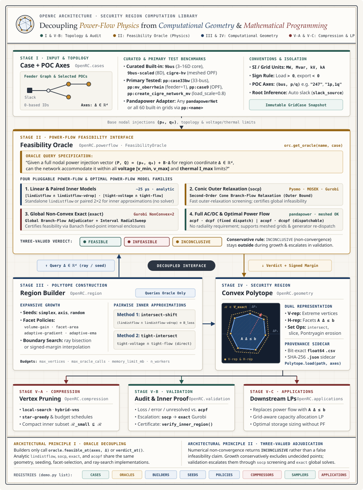
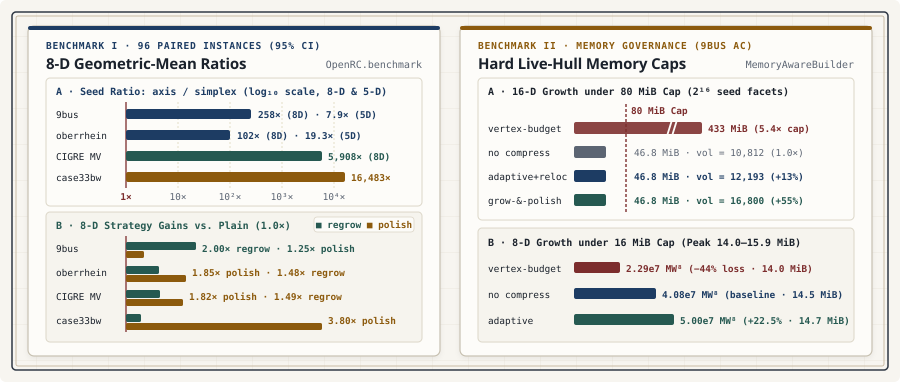

# OpenRC — Open Region Computation Library

[](pyproject.toml)
[](LICENSE)
[](https://doi.org/10.1109/TPWRS.2023.3324246)
[-7c2d2d?style=flat-square)](docs/openrc_guide.pdf)

**Security-region construction, conservative approximation, compression, validation, and downstream optimisation for radial and meshed power networks.**

[**5-Min Start**](#five-minute-start) · [**Networks & Pandapower**](#included-networks-and-pandapower-compatibility) · [**Feasibility Oracles**](#feasibility-oracles-and-the-two-conservative-methods) · [**Region Growth**](#region-construction) · [**Compression**](#compression) · [**Validation & Certification**](#validation-loss-error-and-unresolved-points) · [**Memory & Parallelism**](#memory-and-parallel-execution) · [**Benchmarks**](#benchmarks-with-confidence-intervals) · [**Citation**](#citation)

---

A security region (also called a *hosting-capacity region*, *feasible operating region*, or *dynamic operating envelope*) is the joint feasible set of the power exchanged at selected points of connection (POCs). OpenRC represents it as a convex polytope. Accordingly, repeated grid-aware decisions can use linear constraints instead of rerunning a power flow.

<p align="center">
  
  <br/>
  <em>Figure 1 — OpenRC five-stage architecture decoupling power-flow physics (<code>FeasibilityOracle</code>) from computational geometry and mathematical programming.</em>
</p>

OpenRC consolidates the original 9-bus, conservative-region, adaptive-facet, random-acceleration, and compression scripts behind stable registries. A new case, oracle, builder, policy, sampler, compressor, or application can be added without rewriting the other layers.

## Contents

| Layer | Public module | Responsibility |
|---|---|---|
| [**Cases**](#included-networks-and-pandapower-compatibility) | `OpenRC.cases` | Network data, POC axes, sign/unit conventions, topology, and a guarded pandapower adapter |
| [**Power flow**](#feasibility-oracles-and-the-two-conservative-methods) | `OpenRC.powerflow` | LinDistFlow variants (closed form), SOCP, exact Gurobi, AC and DC oracles; Pyomo, MOSEK or Gurobi modelling layers |
| [**Geometry**](#five-minute-start) | `OpenRC.geometry` | Polytopes, halfspaces, intersections, ray/bisection search, the live hull kept alive while a region grows |
| [**Construction**](#region-construction) | `OpenRC.region` | Seeds, expansive growth, ray strategies, adaptive facet selection and debt screening, memory-aware growth, relocation, two conservative methods |
| [**Compression**](#compression) | `OpenRC.compression` | Local search, star-screened greedy, hybrid VNS, baselines; compression schedules (vertex budget, memory budget, adaptive) |
| [**Validation**](#validation-loss-error-and-unresolved-points) | `OpenRC.validation` | Sampling, loss/error estimates, adjudication, global limit bounds (relaxation screen, parallel global solves), existence proof, [inner-region certification](#verifying-that-a-region-is-inner) |
| [**Applications**](#applications) | `OpenRC.applications` | Capacity allocation and storage sizing |
| [**Execution**](#memory-and-parallel-execution) | `OpenRC.parallel`, `OpenRC.resources` | Worker isolation, batching, time/call/memory budgets |
| [**Benchmarks**](#benchmarks-with-confidence-intervals) | `OpenRC.benchmark` | Random instances, paired runs of any methods, confidence intervals |

Run `python scripts/demo.py list` to inspect every registered implementation. The [user guide](docs/openrc_guide.pdf) (source: `docs/openrc_guide.tex`) develops the methods, their derivations and the measurements in full.

## Installation

Python 3.9 or newer is required. From the repository root (containing
`pyproject.toml`), install the package:

```bash
python -m pip install .
python -c "import OpenRC; print(OpenRC.__version__)"
```

The installed package bundles its built-in case tables and can be imported from
any working directory. The tutorial and command-line drivers live under
`examples/` and `scripts/` in the repository rather than installing console
entry points.

Choose a solver according to the oracle you intend to use:

| Oracle | Solver requirement | Purpose |
|---|---|---|
| `lindistflow` | nothing (closed form); MOSEK or Gurobi with `backend="solver"` | Fast linear DistFlow region construction |
| `lindistflow` ∩ `lindistflow-vdrop`<br/>`tight-voltage` ∩ `tight-flow` | nothing (closed form); MOSEK or Gurobi with `backend="solver"` | Paired two-by-two by `ConservativeBuilder` for the two inner convex approximations (`intersect-shift` & `tight-intersect`) |
| `socp` | MOSEK or Gurobi through Pyomo | Outer-relaxation screening; 1 MVA per-unit scaling |
| `exact` | Gurobi with `NonConvex=2` | Global branch-flow adjudication; 1 MVA per-unit scaling |
| `acpf`, `dcpf` | `pandapower` only | Reference checks and screening (fixed dispatch) |
| `dcopf`, `acopf` | `pandapower` only | Optimal power flow: **no radiality requirement** |

Explicit calls to a missing solver raise `SolverUnavailableError` (a
`RuntimeError`), whereas optional adjudication stages mark that stage
unavailable and leave the point unresolved. When an installed solver lacks a
valid license or fails at runtime, its queries return `INCONCLUSIVE` and the
error is logged once on the `OpenRC` logger.

## Five-minute start

The tutorial script is self-contained and executable:

```bash
python examples/tutorial.py            # quick start: first region + equation candidate
python examples/tutorial.py --list     # list all tutorial steps
python examples/tutorial.py --all      # full tutorial, including validation and 8-D resources
python examples/tutorial.py 4 6 7      # selected steps only
```

Minimal Python API:

```python
import OpenRC as orc
from OpenRC.region.expansive import ExpansiveBuilder

case = orc.get_case("9bus")
axes = case.resolve_axes("247")          # paper POCs 2, 4, 7
with orc.get_oracle("lindistflow", case) as oracle:
    run = ExpansiveBuilder(
        policy="adaptive-gradient",
        seed="random",
        seed_kwargs={"n_samples": 2_000, "batch_size": 500},
        n_workers="auto",
    ).build(
        case,
        axes,
        oracle,
        max_vertices=120,
        max_oracle_calls=20_000,
        memory_limit_mb=4_096,
    )
region = run.polytope

small = orc.get_compressor("local-search").compress(
    region, target_vertices=20
).polytope
quality = orc.evaluate_region(
    small, case, axes, reference="acpf", n_samples=1_000,
    n_workers="auto", escalate_to=("socp", "exact"),
)
print(run.summary())
print(quality.summary())
```

> [!IMPORTANT]
> This quick-start example grows a `lindistflow` model region, **not** an AC inner-region certificate; the AC validation can therefore report violations. For the two paper-derived inner approximations, use `ConservativeBuilder` and verify the result as described in [Verifying that a region is inner](#verifying-that-a-region-is-inner).

Equivalent command-line workflows:

```bash
python scripts/demo.py case --case pp:mv_oberrhein --feeder 1
python scripts/demo.py region --case 9bus --axes 247 \
    --seed random --seed-samples 2000 --seed-batch-size 500 \
    --policy adaptive-gradient --workers auto \
    --max-vertices 120 --max-oracle-calls 20000 \
    --memory-limit-mb 4096 --out out/
python scripts/demo.py conservative --case 9bus --axes 247 --validate 800
python scripts/demo.py bench-policy --case 9bus --axes 247
python scripts/demo.py memory --case 9bus-scaled --axes all8 --rounds 4
```

<p align="center">
  
  <br/>
  <em>Figure 2 — Deterministic 3-D security region on <code>9bus</code> (axes <code>247</code>: <code>b1p</code>, <code>b3p</code>, <code>b6p</code>) with 13 hull vertices and 22 halfspace facets (generated by <code>python scripts/generate_readme_figures.py</code>).</em>
</p>

## Conventions

- Units at every public interface are MW, Mvar, kV, and kA. SI conversion for the DistFlow equations occurs in one module.
- Positive nodal power means consumption. A negative region coordinate means generation/export.
- A region axis is a `(bus, quantity)` pair. `247` is a named preset; `1,3,6` specifies active-power buses explicitly; `1p,1q,3p` creates mixed active/reactive axes.
- Bus indices in code are zero-based. Preset names retain the one-based POC labels used in the papers.
- The feeder root is detected automatically; no caller nominates it. `case.slack_source` records how it was decided.
- Every saved region has a CSV vertex table and a JSON provenance sidecar.

Presets belong to a case: `247` is a 9-bus preset. On a different case, such
as `pp:mv_oberrhein`, specify axes explicitly, for example
`--axes 30p,60p,90p`. Qhull-backed region construction needs at least two axes;
single-axis feasibility queries remain valid.

Oracle provenance records `case_configuration_id`, `slack_vm_pu` and
`line_charging`, so identically named cases with different physical inputs can
be distinguished. Save a construction with `run.save(...)` to retain its
builder settings and oracle provenance alongside the geometry. Refinement
preserves existing metadata and records the oracle used for the moves.
Q-capability callbacks can use pure Python functions, lambdas, closures or
standard interpolation objects. Keep physical parameters in explicit captures,
defaults or callable state: snapshots copy those parameters and include them
in the configuration fingerprint. Pandapower spline caches are excluded from
the fingerprint because evaluating an unchanged curve does not change its
physical inputs.

<details>
<summary><b>Geometry snapshot immutability &amp; CSV/JSON SHA-256 integrity contract</b></summary>

Stored regions act as immutable geometry snapshots: input vertex arrays are
copied, stored vertices and halfspaces are read-only, and reassigning geometry
clears the cached hull and volume. Use `region.replace(vertices=new_vertices)`
to derive a modified polytope. `Polytope.load(path, axes=...)` and set
intersections both verify that axis labels and ordering match, preventing a
saved vertex table from being paired with the wrong bus quantities. Keep each
CSV file together with its JSON sidecar: saving stages both files before
replacing the targets and records the CSV's SHA-256 checksum in the sidecar so
mismatched or modified pairs are rejected on load (legacy files without a
checksum remain readable, and the checksum serves only for accidental-change
detection). CSV coordinates are parsed with exact `float64` round-trip
conversion.

</details>

## Included networks and pandapower compatibility

| Case | Buses / branches | Primary role in testing, examples, and benchmarks |
|---|---:|---|
| `9bus` | 9 / 8 | Built-in Dutch 10.5 kV feeder; primary testbed for 3-D/4-D/8-D/16-D region growth, conservative inner methods, inner-region certification, and live-hull memory caps |
| `9bus-scaled` | 9 / 8 | Built-in 9-bus variant (ratings ×6, cable lengths ÷3); high-dimensional 8-D growth and vertex-compression studies |
| `cigre-hv` | 13 / meshed | Built-in 380 kV CIGRE HV network with transformers; primary meshed optimal power flow (`dcopf`, `acopf`) testbed |
| `pp:case33bw` | 33 / 32 | IEEE 33-bus (Baran–Wu) 12.66 kV radial feeder; cross-network 3/5/8-D benchmarks, interval `RadialSweep`, AC warm-start guard, and unrated-line handling |
| `pp:mv_oberrhein`, `feeder=1` | 109 / 108 | One radial substation area of pandapower's 20 kV MV Oberrhein grid; large-feeder growth, worker scaling, oracle/ray/certification timing, and 3/5/8-D benchmarks |
| `pp:create_cigre_network_mv`, `load_scale=0.8` | 15 / 14 | 20 kV CIGRE MV feeder (2 collapsed transformers, 3 open ties); transformer-collapse, line-charging, and cross-network 3/5/8-D benchmarks |
| `pp:case9` | 9 / meshed | WSCC 9-bus 345 kV transmission ring; meshed radiality guard and `dcopf` tutorial/regression testbed |
| `pp:<name>` | — | Every network in `pandapower.networks` (60 in pandapower 3.4.0 and 3.5.6) and any custom `pandapowerNet` imported on demand |

Any custom `pandapowerNet` (in-memory or JSON) and every network built into `pandapower.networks` (**60** in pandapower 3.4.0 and 3.5.6; the catalogue depends on the installed version) are directly compatible:

```python
import pandapower as pp
import OpenRC as orc

case = orc.get_case("pp:case33bw")                        # any built-in pandapower network
case = orc.get_case("pp:mv_oberrhein", feeder=1)          # one radial feeder area of a two-substation network
case = orc.case_from_pandapower(pp.from_json("net.json")) # or your own pandapowerNet
orc.classify_pandapower_networks()                        # inspect which oracles apply
```

The adapter preserves single-open line and transformer terminals in the AC
model, including the connected end's charging current, and preserves
finite-impedance bus couplers. The DistFlow conducting tree excludes open
branches; its default omits line shunts, while `line_charging="constant"`
rejects single-open capacitive lines whose terminal equivalent is unsupported.
Finite-impedance bus couplers require AC/DC/OPF. These distinctions follow
[pandapower's switch model](https://pandapower.readthedocs.io/en/stable/elements/switch.html).
At disconnected buses, nonzero total requested power is rejected even if the
solver converges after dropping the bus. AC checks P and Q; DC checks P only.
Cancelling the base load to a zero total request is allowed.

Fixed-power requests are offset against the native load, static-generation
and storage actually present, including supported static-generator limit
clipping. Separately declared case bases therefore define the requested
operating point without shifting the realised fixed-power target. Native PV,
shunt and ZIP devices retain their own behaviour. Thermal checks always
request branch results, even when the original network requests voltage-only
output. FACTS compensators and AC/DC converters remain in the native models
and explicitly disable the series-only DistFlow family.

> [!NOTE]
> **Radiality restricts the DistFlow family only.** Out of the 60 networks bundled with pandapower 3.4.0 and 3.5.6, **27** are radial trees eligible for closed-form/conic DistFlow, SOCP, and exact branch-flow oracles, while **33** (meshed, multi-infeed or disconnected grids, and one tree whose voltage-controlled generator and shunt the branch-flow models cannot represent) work directly with the AC/DC power-flow oracles (`acpf`, `dcpf`), and with the optimal-power-flow oracles (`acopf`, `dcopf`) where the network carries generator costs and limits. Inspect `case.radiality.message` on any case, and see Chapters 4–5 of the [user guide](docs/openrc_guide.pdf) for adapter conversion details, unrated-line handling (`default_rating_ka`), and snapshot isolation.

## Feasibility oracles and the two conservative methods

> [!IMPORTANT]
> Each oracle query returns `FEASIBLE`, `INFEASIBLE`, or `INCONCLUSIVE`. Non-convergence of a local power-flow solver does not prove that no feasible operating point exists, so solver-backed oracles report `INFEASIBLE` only on an explicit infeasibility certificate. Pyomo's `noSolution`, `infeasibleOrUnbounded`, timeouts, and numerical failures remain `INCONCLUSIVE`; validation can escalate them and excludes unresolved points from the error-rate denominator. Candidate checks reject undefined, negative, or non-finite constraint residuals, including overflow of a cone product when the candidate itself is finite.

### LinDistFlow family (four linear models, paired into two inner approximations)

All four linear branch-flow oracles share one implementation (`DistFlowOracle`). Used alone, `lindistflow` builds a standard linear DistFlow region; **paired two-by-two**, they form the two conservative inner-approximation methods in `ConservativeBuilder`:

- **Pair 1 (`method="intersect-shift"`, Method 1)**: intersects `lindistflow` (Model I) and `lindistflow-vdrop` (Model II) to bracket the voltage-drop loss term, then erodes by the balance-loss box.
- **Pair 2 (`method="tight-intersect"`, Method 2)**: directly intersects `tight-voltage` (Model I) and `tight-flow` (Model II), which conservatively bound voltage drops and branch flows respectively.

| Public oracle | Balance loss | Voltage term in `v_child` | Thermal limit | Pairing role |
|---|---|---|---|---|
| `lindistflow` | dropped | dropped | nameplate | Standalone linear DistFlow; or **Pair 1 (`intersect-shift`) · Model I** |
| `lindistflow-vdrop` | dropped | `+(r²+x²) l_max` | nameplate | **Pair 1 (`intersect-shift`) · Model II** (voltage-loss upper bracket) |
| `tight-voltage` | dropped | `+(r²+x²) l_max` | path-tightened | **Pair 2 (`tight-intersect`) · Model I** (tightened voltage & thermal) |
| `tight-flow` | `+r l_max`, `+x l_max` | dropped | nameplate | **Pair 2 (`tight-intersect`) · Model II** (worst-case balance loss) |

<p align="center">
  
  <br/>
  <em>Figure 3 — Geometric pairing of the four linear DistFlow oracles into Method 1 (<code>intersect-shift</code>: voltage-drop bracket plus Pontryagin loss erosion) and Method 2 (<code>tight-intersect</code>: direct intersection of path-tightened models).</em>
</p>

**Closed-form evaluation.** On a radial tree, none of these models has a free decision variable: branch balances fix the flows from the leaves toward the root, and voltage drops integrate outward from the slack bus:

$$\mathbf{P} = \mathbf{T}\mathbf{p} + \mathbf{c}_P, \qquad \mathbf{v} = v_0\mathbf{1} - 2\mathbf{T}^\top(\mathbf{r}\circ\mathbf{P} + \mathbf{x}\circ\mathbf{Q}) + \mathbf{c}_v$$

with $\mathbf{T}$ the sparse subtree incidence. Voltage and thermal inequalities are checked directly on the resulting vectors. `backend="analytic"` is the default (20–30 µs per query, with `feasible_mask` evaluating a batch in one matrix product), while `backend="solver"` retains the conic formulation as an independent cross-check. Away from the boundary the two backends agree; within roughly 3.5e-5 along a ray they can differ within solver feasibility tolerances (for example, Gurobi's default 1e-6 tolerance on squared voltage accepts 0.8999994 p.u. against a 0.9 limit). Building a 120-vertex 9-bus region takes 0.07 s analytically versus 2.4 s through a solver.

### Modelling layers

`socp`, `exact` and the DistFlow oracles with `backend="solver"` take `modeling=`:

- `"pyomo"` (default) is the portable reference, with `solver=` choosing any Pyomo solver.
- `"mosek"` (Fusion) and `"gurobi"` (gurobipy) state the same model directly in the solver's API. It is built once and kept between queries, and a query changes only the injection data.
- MOSEK is convex-only, so the exact oracle accepts `"pyomo"` or `"gurobi"`.

A new layer is one class registered in `MODELING_LAYERS` (`OpenRC/powerflow/modeling.py`). It receives the oracle's `ConicForm`: `A x = b + B u`, bounds, and one flow cone per branch.

| 9-bus, per query | `pyomo` | `mosek` | `gurobi` |
|---|---:|---:|---:|
| DistFlow, `backend="solver"` | 0.88 ms | 0.09 ms | 0.04 ms |
| `socp` | 1.28 ms | 0.48 ms | 0.19 ms |
| `exact` | 2.89 ms | — | 1.17 ms |

```python
orc.get_oracle("socp", case, modeling="gurobi")
orc.get_oracle("lindistflow", case, backend="solver", modeling="mosek")
```

```bash
python scripts/demo.py region --case 9bus --axes 247 --oracle-option backend=solver --oracle-option modeling=gurobi
```

### Optional equation candidates before the optimiser

`ConicForm` is also an executable equation interface. A solver-backed DistFlow
or SOCP oracle may ask a local method for a candidate first; OpenRC then
rechecks the equality residual, variable bounds, non-negative rotated-cone
factors, and every cone inequality. Only a candidate below the strict scaled
tolerance is accepted. If the local method fails to converge or violates a
residual tolerance, the candidate is treated as `INCONCLUSIVE` and the reference
optimiser runs automatically.

The feature is opt-in:

```python
oracle = orc.get_oracle(
    "lindistflow", case,
    backend="solver",                 # keep the optimiser as the fallback
    modeling="mosek",
    candidate_solver="newton",       # or "gauss-seidel"
    candidate_tolerance=1e-9,
)
verdict = oracle.verdict_at(axes, point)
print(oracle.candidate_stats.as_dict())
print(oracle.describe()["last_candidate_certificate"])
```

For both conservative constructions, pass the same options to their two
component oracles:

```python
from OpenRC.region.conservative import ConservativeBuilder

builder = ConservativeBuilder(
    method="tight-intersect",
    oracle_kwargs={"backend": "solver", "candidate_solver": "newton"},
)
```

The same settings are available from the command-line driver:

```bash
python scripts/demo.py conservative --case 9bus --axes 247 \
  --oracle-option backend=solver --oracle-option candidate_solver=newton
```

For the four linear DistFlow models, the equations form a square affine system
on the tree with a unique solution. `backend="analytic"` already evaluates that
solution directly, decides both feasible and infeasible queries, and vectorises
batches; it remains the fastest choice. On 9-bus queries, the reusable equation
layer took about 0.036 ms per Newton solve and 0.71 ms with Gauss–Seidel,
compared with 0.02–0.03 ms for the closed-form backend. The equation layer is
intended for cross-checking against an optimiser backend and for custom models
without a closed form. Sparse LU factors or Gauss–Seidel row matchings are built
once per oracle, so memory scales with network size rather than the number of
queried points.

**Certified sweeps for SOCP and exact** (`candidate_solver="sweep"`). Through the oracles, the interval-certified backward/forward sweep makes the `exact` oracle **2.1× (`9bus`) to 3.6× (`case33bw`) faster** per query with identical verdicts; for `socp` it pays only where the conic solve is expensive:

```python
orc.get_oracle("exact", case, candidate_solver="sweep")
orc.get_oracle("socp", case, modeling="gurobi", candidate_solver="sweep")
```

<details>
<summary><b>Banach fixed-point sweep derivation, outward interval arithmetic &amp; custom SciPy solvers</b></summary>

Generic methods do poorly on `socp`: the exported equations are the linear
ones only, so the system is under-determined, and a Newton candidate is
rarely accepted (`exact` also exports its quadratic branch-flow equalities,
forming a square non-convex system, though a local root finder still neither
guarantees global convergence nor respects inequality bounds on its own). Every oracle therefore
switches a candidate off after `candidate_patience` attempts (20) below
`candidate_min_rate` (5 %). Provenance records the exact `disabled_after`
attempt. Candidate counts must be positive integers (fractional values raise
`ValueError`).

The two-bus model reduces to a quadratic. For larger feeders, OpenRC uses an
iterative backward/forward sweep rather than a general closed-form solution.
Each *step* has the closed form

$$F(V) = \mathbf{1} - \mathbf{T}^\top\!\bigl(\mathbf{z} \circ \mathbf{T}\operatorname{conj}(s / V)\bigr)$$

(unit slack voltage). Once the iterate settles at $\hat{V}$, compute
$\delta = \|F(\hat{V}) - \hat{V}\|_\infty$ and a Lipschitz bound $L(r)$ on the closed infinity-norm ball
of radius $r$ around $\hat{V}$. Require

$$0 < r < \min_i |\hat{V}_i|, \qquad L(r) < 1, \qquad \delta \le r\bigl(1 - L(r)\bigr).$$

Banach's theorem then gives exactly one solution **in that
ball**, at distance at most $\delta / (1 - L(r))$ from $\hat{V}$; it does not establish global
uniqueness. A point is proven feasible only when every voltage and rated current
still meets its limit throughout that enclosure. The sweep never claims
infeasibility.

`RadialSweep.last_certificate` exposes the residual, ball radius, Lipschitz
bound, error bound, and post-enclosure voltage/current margins for inspection and
custom policies.

Because floating-point arithmetic is subject to rounding, `certificate="interval"`
(the default) re-evaluates every point that passes the floating-point test in
outward-rounded interval arithmetic (`OpenRC/powerflow/interval.py`). IEEE 754 rounds `+ − × ÷ √`
correctly, so moving each bound one ulp outward encloses the exact result. The
proof recomputes $F(\hat{V})$, $\delta$, $L$, the error bound and every limit margin in
this way, starting from the stored data, so the conditions hold over the reals.
The certificate's `rigorous` field is then `True`.
`candidate_options={"certificate": "float"}` keeps the floating-point test
alone. The enclosures were checked against exact rationals and 60-digit mpmath
with no failure. The proof changed no verdict on 720 points; it is stricter only
within a few ulps of the floating-point edge (relative 2e-15 to 1.3e-13 along
random rays).

On 720 random points over three networks it proved every exact-feasible point,
with no unsound acceptance, at 0.3–0.5 ms per point with the interval proof
(0.1–0.2 ms with the floating-point test alone). For SOCP it pays only where the conic solve is expensive:
it is up to 2.1× slower on the small networks, where Gurobi
solves the SOCP in 0.2–1 ms. Structured candidates live in
`STRUCTURED_SOLVERS`; discover them without private access through
`orc.list_structured_solvers()`.

Custom equation methods still pass the full constraint checker. Non-numeric
candidates, invalid counters and malformed candidate results cannot interrupt
the reference-optimiser fallback; invalid starting points are skipped so later
starts can still succeed. A structured provider must return `EquationResult`
and enforce its own feasibility/certificate contract, as the built-in sweep
does; type/timing validation alone is not a proof for an arbitrary plugin.

To plug in SciPy or a custom root finder, obtain the public equation problem
from `oracle.equation_problem`:

```python
from scipy.optimize import least_squares

p_mw, q_mvar = case.injection_vector(axes, point)
problem = oracle.equation_problem(p_mw, q_mvar)
answer = least_squares(
    problem.fun, problem.x0, jac=problem.jac, bounds=problem.bounds,
)
if problem.accepts(answer.x):          # always perform this final check
    print(dict(zip(problem.names, answer.x)))
```

`problem.fun`, `jac`, `x0`, and `bounds` follow SciPy conventions. The separate
`problem.check(x)` explains the maximum scaled equality, bound, and cone
violations. Register a reusable algorithm in `EQUATION_SOLVERS`; its function
returns `(candidate, equations_converged, iterations, message)`, while OpenRC
retains control of final acceptance. Registered names survive worker
reconstruction more reliably than lambdas or stateful solver instances.
`candidate_starts=` and `candidate_seed=` provide deterministic multi-start for
under-determined or nonlinear systems; square affine DistFlow has a unique
solution, so its cached LU factorisation runs a single solve regardless of
`candidate_starts`.

</details>

### Method 1: `intersect-shift`

1. Build Model-I and Model-II regions.
2. Intersect them to bracket the voltage-loss term: $\bar{\mathcal{C}} = \mathcal{C}^{\mathrm{I}} \cap \mathcal{C}^{\mathrm{II}}$.
3. Absorb the loss the balance equations drop. The exact model adds $r \cdot \ell$ to every branch's active flow **and** $x \cdot \ell$ to its reactive flow, at the same time, with $\ell \in [0, \ell_{\max}]$. For every POC $j$ the region is therefore shifted along $P_j$ by $r \cdot \ell_{\max}$ and along $Q_j$ by $x \cdot \ell_{\max}$. A point is kept only if it stays in $\bar{\mathcal{C}}$ under **every combination** of these shifts: the whole box of losses $\mathcal{B}_{\mathrm{loss}}$.
4. Optionally clip to the POC ratings.

Along a direction that is an axis of the region, a shift is a translation. The whole box of on-axis shifts is absorbed exactly by a Pontryagin difference ($\bar{\mathcal{C}} \ominus \mathcal{B}_{\mathrm{loss}}$): each facet $\mathbf{a}^\top \mathbf{y} \le b$ tightens to

$$\mathbf{a}^\top \mathbf{y} \le b - \sum_k \max(0, a_k s_k)$$

(`erode_by_box`). Along a direction that is not an axis, the shifted copy is the **slice** of the feasible set with the base injection at $j$ raised by the shift. The typical case is the $Q_j$ direction of a region over active power only. The slice is computed by rebuilding both component regions at that base through `OffsetOracle`, and every corner of the off-axis box contributes its slice. With $k$ off-axis directions that is $2^k$ slice builds. All of it is exact on inequalities, and the vertices are enumerated once, at the end.

```python
from OpenRC.region.conservative import ConservativeBuilder

builder = ConservativeBuilder(
    method="intersect-shift",
    shift_scope="path",   # default: loss bound over the complete upstream path
)
```

`shift_scope="feeding_branch"` charges only the branch feeding each POC. That is exact when every bus is a POC. On a reduced set of POC coordinates it can miss a downstream POC's load on an upstream branch whose loss no retained coordinate carries; a deterministic counterexample is documented below. Let the builder certify any region you rely on:

```python
builder = ConservativeBuilder(method="intersect-shift", certify=True)
```

### Method 2: `tight-intersect`

Method 2 directly intersects two complementary conservative model regions: Model I carries the upper voltage-loss term and path-tightened thermal bound; Model II charges maximum balance losses and retains the nameplate thermal bound. It does not translate the final region.

```python
builder = ConservativeBuilder(method="tight-intersect")
```

Both methods carry the paper-derived inner-approximation claim, subject to their modelling assumptions, solver tolerances, and correct network data. The certificate - global limit bounds with existence proven at every point - passed both on every 4-D configuration tried (see [Verifying that a region is inner](#verifying-that-a-region-is-inner)). Result metadata marks a region `theorem_backed` for Method 1 when every lossy branch feeds a region bus, and for Method 2 with `oracle_kwargs={"tighten_scope": "subtree"}`: Model I then tightens each branch by its own subtree's losses and checks the thermal limit at the minimum voltage, which bounds every combination of branch losses (a fixed-point argument; see `OpenRC.region.conservative`). Otherwise the loss of a branch feeding another bus (Method 1), or a mixed combination of branch losses (Method 2 with the default path scope), can escape both component models. Validate a result against an appropriate reference before operational use.

### Optimal power flow, and what "feasible" means

The DistFlow family asks whether a *fixed* injection pattern respects the limits. On a meshed network with controllable generation the useful question is whether the system can be **dispatched** to accommodate it — an optimal power flow. The four verdicts on the CIGRE-HV base point show what changes:

| Oracle | Verdict | Question asked |
|---|---|---|
| `dcpf` | feasible | fixed dispatch, thermal limits only |
| `acpf` | infeasible | fixed dispatch violates the voltage envelope |
| `dcopf` | feasible | a dispatch exists |
| `acopf` | feasible | a dispatch exists in the AC model |

For both OPF oracles, a converged solver result proves feasibility. A generic
exception or non-convergence maps to `INCONCLUSIVE`, because pandapower's
wrapper has not supplied a solver certificate that distinguishes true
infeasibility from a numerical or modelling failure.

Both need an **OPF-ready** network — controllable generators with power limits and a cost on at least one. If generator bounds or objective costs are missing, the oracle raises `NotOpfReadyError`. `cigre-hv` supplies documented default bounds and costs in its case factory.

The interior-point AC-OPF is sensitive to its start. `acopf` tries a
power-flow solution first and then a flat start (`inits=("pf", "flat")`) and
calls a point feasible once one of them converges. From a flat start alone it
converged on only 6 of 40 random points, and not at the CIGRE-HV base point;
with both starts it converged on 39 of 40, agreeing with `dcopf` on 39, in
less time. `inits=("flat",)` restores the single attempt. Screen with `dcopf`
first where no start converges.

## Region construction

The expansive builder starts with a full-dimensional seed, repeatedly selects a facet, fires a ray through it, and adds the certified boundary point. If a ray remains feasible up to `max_ratio`, the search raises `UnboundedRayError` instead of placing an artificial boundary vertex.

<p align="center">
  
  <br/>
  <em>Figure 4 — Computational-geometry pipeline: orthant-spanning <code>axis</code> seed vs. one-sided <code>simplex</code> seed (left), bandit-guided ray bisection &amp; Jacobi volume-gradient relocation (centre), and in-place star-screened vertex pruning on <code>LiveHull</code> (right).</em>
</p>

### Facet policies

| Policy | Selection rule | Expensive boundary searches per round | Measured |
|---|---|---|---:|
| `volume-gain` | Maximum realised hypervolume gain | `d`, the child facets created by one break | 3.03 / 4.03 / 8.06 at `d` = 3 / 4 / 8 |
| `facet-area` | Largest facet | 1 for the selected facet | 1.00 |
| `cone-volume` | Largest facet-to-origin cone | 1 | 1.00 |
| `generation` | Oldest facet first | 1 | 1.00 |
| `random` | Uniform facet | 1 | 1.00 |
| `adaptive-ema` | Full-information EMA bandit over nominated facets | up to number of arms | 1.04 |
| `adaptive-egreedy` | EMA plus epsilon exploration | up to number of arms | 1.07 |
| `adaptive-gradient` | Softmax arm sampled before reward evaluation | **1** with the default cheap arms | 1.00 |

Boundary points are cached per facet, so a facet that survives a round is never
re-searched. `volume-gain` therefore costs one search per *newly created* facet,
which is `d` per break, not one per queued facet — the queue averaged 41 facets
in the `d = 3` measurement above while the policy used 3.03 searches per round.
The adaptive policies mostly reuse cached candidates because their cheap arms
frequently nominate the same facet, which is why they sit so close to 1.00.

The gradient policy updates from the realised gain in `observe`; it does not precompute every arm's expensive gain. Each policy reports arm probabilities and pick counts in result metadata.

A cached gain is measured when its facet is first scored. Later insertions can
cover part of that cap, so a greedy `volume-gain` would rank on stale values.
With `refresh_gains=True`, the default of `ExpansiveBuilder` and of the
`facet-queue` and `grow-and-polish` ray strategies, a queued facet's gain is
re-measured on the current hull from its cached boundary point, at no oracle
cost. At equal vertex counts this gives `volume-gain` 1.44× (3-D), 1.63× (5-D)
and 107× (8-D, 64 vertices) the volume of first-measurement scoring; the
adaptive policies are unaffected. `refresh_gains=False` scores as the published
method did. Refreshing costs geometry, not oracle calls: only the gains an
insertion can change are re-measured, from facet areas once that pays (8-D
`volume-gain`, 120 vertices: 17.5 s, against 5.8 s without refresh and 74 s
re-measuring every gain; `adaptive-ema` within 3 %). `lazy=False` on an
adaptive policy scores every queued facet, as the unaccelerated method did: the
same rule at a higher search cost.

### Seeds and random acceleration

- `simplex`: `d+1` boundary rays.
- `axis`: `2d` signed axis rays and an axis-intercept sampling box.
- `random`: axis seed plus uniform or Sobol points from that box.

The sampling box spans the axis intercepts through the chosen origin. Coupled
P/Q coordinates can have feasible points beyond those intercepts, so it does
not generally enclose the entire feasible set.

A random feasibility test is one oracle call; a boundary ray usually needs dozens. Large random starts are processed in bounded batches and each batch is reduced to its hull before the next is created. Removing a point interior to a batch hull cannot remove a vertex of the final union hull, so this memory reduction is exact. A seed hull that already has more than `max_vertices` vertices is reduced to `max_vertices` of its vertices, with a warning: greedy volume insertion from a large simplex, the vertex adding the most volume next. It stays within 2 percentage points of the volume greedy removal keeps and is 100 to 1,000 times faster in 5- to 8-D (an 8-D seed of 1,010 vertices: 0.9 s). `builder_info["seed"]` records `exceeds_max_vertices`, `seed_compressed_to`, `seed_compression` and `seed_volume_loss_pct`. For `ExpansiveBuilder`, `max_vertices` counts the points inserted (each costs a boundary search), so a point that later falls inside the hull still counts; the ray-growth engine caps the hull's vertices.

`ExpansiveBuilder` defaults to `seed="auto"`: `axis` from 4-D up, `simplex` in 3-D and below; a seed passed explicitly is always used as given. The simplex seed is one-sided (positive unit axes plus one negative diagonal) and facet-centroid rays never undo that bias; the gap grows exponentially with dimension. Volume with the axis seed over the simplex seed on `9bus` (AC oracle, `adaptive-ema`, similar oracle calls):

| Dimension | 3 | 4 | 5 | 6 | 7 | 8 | 16 |
|---|---:|---:|---:|---:|---:|---:|---:|
| axis / simplex | 1.3 | 3.8 | 21 | 101 | 3 120 | 2 410 | 27 900 |

The 4-D threshold comes from the benchmark harness, over random instances (`scripts/benchmark.py`: 8 per network, P/Q axes, LinDistFlow). The axis seed won every 4-D instance, with a geometric-mean volume ratio to the simplex seed of 2.3 on `9bus` and 38 on `pp:case33bw` at 20 vertices per dimension. It also won all but one 3-D instance, by 1.16 and 4.4. In 3-D `"auto"` keeps the simplex so published results reproduce; pass `seed="axis"` for more volume there too.

The region CLI forwards `--seed auto` (its default) to either growth engine,
which applies the same rule.

### Ray strategies

`RayGrowthBuilder` (`"ray-growth"`) separates *which ray to fire* from *what the engine does with it*. A `RayStrategy` proposes a direction and an action (add a vertex, or replace vertex `i`) with an optional boundary-distance hint; the engine fires the bisection (cached by direction, warm-started at the hint), evaluates the exact volume the action gives on the live hull, applies the acceptance rule (default: strictly more volume), enforces the vertex cap and the hard memory cap, and restores the best state it saw.

| Strategy | What it proposes |
|---|---|
| `facet-queue` | the expansive builder's virtual facet queue with any facet-selection policy |
| `facet` | the best real facet by predicted gain (or cone, area, or your own score), with lookahead |
| `gradient` | relocation moves plus Linde–Buzo–Gray splitting while the budget has room |
| `relocation` | moves only, at a fixed vertex count |
| `grow-and-polish` (default) | `facet-queue` until a cap binds, then `relocation` |

```python
from OpenRC.region.ray_growth import RayGrowthBuilder, RayProposal, RayStrategy

RayGrowthBuilder(strategy="grow-and-polish").build(case, axes, oracle,
                                                   max_vertices=60, max_hull_mb=16)

class RandomDirections(RayStrategy):          # your own; register it or pass the instance
    def propose(self, ctx):
        return RayProposal(direction=ctx.rng.normal(size=ctx.dim)) if ctx.room else None
```

A strategy sees a `RayContext` — the live hull, vertex radii and directions, the exact volume gradient, facet directions, origin cones and predicted gains, each computed once per hull state — and can probe with `ctx.boundary(direction, hint)` through the shared ray cache. `SequentialRays` chains strategies; `accept` can be overridden. Proposals are validated: a non-finite direction or an out-of-range vertex is an error.

Without a memory budget, at a fixed vertex count (`9bus`, AC oracle):

| | 8-D, 60 vertices | calls | 16-D, 40 vertices | calls |
|---|---:|---:|---:|---:|
| `ExpansiveBuilder`, `adaptive-ema` | 3.28e6 | 1 503 | 65 822 | 924 |
| `ray-growth`, `facet-queue` | 4.44e6 | 1 296 | 65 564 | 884 |
| `ray-growth`, `grow-and-polish` | 6.62e6 | 5 122 | 155 190 | 3 816 |

The facet queue inside the engine gives more volume for fewer calls (warm-started bisections; a vertex budget spent on hull vertices only), and polishing at the budget doubles the 8-D region. The `gradient` strategy alone grows much more slowly: in high dimension breadth of directions matters more than local moves.

## Compression

| Compressor | Description |
|---|---|
| `local-search` | Greedily remove the vertex with minimum marginal volume loss (exact, computed from each vertex's neighbourhood) |
| `star-screened` | Greedy for high dimension: star volumes screen the candidates, exact losses for a short list only |
| `hybrid-vns` | Greedy pruning plus variable-neighbourhood backward recycling |
| `roulette` | Randomised choice among the least harmful removals |
| `random` | Uniform removal baseline |

All compressors return an inner polytope made from retained input vertices. The result includes volume loss, timing, and method-specific trace data. They work in place on a live hull (`compress_live`), which is how the memory-aware builder compresses without rebuilding; besides a vertex target and a loss budget, a live compression can stop at a measured memory goal and refuse any removal above a price. Compression reduces storage and downstream constraint count. Axis-aligned POC
clipping is likewise performed directly with `2d` halfspaces rather than
materialising `2^d` box corners.

## Validation: loss, error, and unresolved points

For sampled points, let:

- $N_R$ be the points accepted by the region;
- $N_D$ be the points proven feasible by the reference/adjudication chain;
- $N_{RD}$ be their intersection;
- $N_{U,R}$ be unresolved points inside the region.

OpenRC reports the conditional rates users normally intend:

$$\text{error rate} = 1 - \frac{N_{RD}}{N_R - N_{U,R}}, \qquad \text{loss rate} = 1 - \frac{N_{RD}}{N_D}$$

The loss numerator is $N_{RD}$, not all $N_R$; therefore the loss rate cannot become negative merely because a candidate region contains infeasible points. The loss rate is conditional on the chosen sampling domain and distribution; it is not the fraction of the entire feasible set lost outside that domain. Independent draws include Wilson 95% intervals. Sobol sequences, scenarios sampled without replacement, and custom samplers that do not declare independent draws retain their point estimates but report no binomial interval (`NaN` bounds).

<p align="center">
  
  <br/>
  <em>Figure 5 — Conditional set-measure partition and the small-corner refutation on <code>9bus/247</code> (left), paired with the four-stage deterministic escalation and global surface certificate (right).</em>
</p>

Samplers accept non-negative integer counts and return `(0, dim)` for an empty
draw; Sobol accepts integer, NumPy-integer and `numpy.random.Generator` seeds.
Explicit box bounds must be given together, finite, ordered and of matching
dimension, and extreme finite endpoints are interpolated without overflow.
Surface sampling weighs facets with the stable simplex measure, so a slender
facet cannot vanish through Gram cancellation, and uses row-scaled log-area
weights when absolute areas are not representable. Rejection sampling obeys its
draw budget; `InRegionSampler(method="auto")` falls back to volume-weighted
facet cones when rejection cannot sample a thin body (choose `"rejection"` or
`"cones"` explicitly to control this). When all in-region samples remain undecided, the error rate is undefined
(`NaN`), and zero observed violations in finite sampling provides only a
statistical bound rather than an inner-region certificate.

### Evidence-aware adjudication

Disputed points pass through a multi-stage escalation chain before being classified:

1. AC power flow retries multiple algorithms/initialisations.
2. Optional SOCP provides directional evidence: infeasibility of an outer relaxation proves exact infeasibility, but SOCP feasibility does **not** prove exact feasibility.
3. The Gurobi nonconvex branch-flow model attempts an exact verdict.
4. Solver timeout or numerical failure remains `INCONCLUSIVE`; the point is listed and excluded from the error-rate denominator.

Likewise, rejection by an inner approximation does not prove exact infeasibility. Each oracle declares these directional guarantees through capability flags read by the adjudicator.

With `adjudicate=True` (default), every answer lacking reference evidence is
escalated, including a component/outer model's acceptance and a local AC
rejection **outside** the region. Otherwise missed feasible points could be
omitted from the loss estimate. A weak reference can therefore escalate every
sample; use `reference="acpf"` for a cheap first-stage physical witness, or
`reference="exact"` for direct branch-flow decisions. `adjudicate=False`
retains model-relative comparisons without claiming AC guarantees for DC or
linear models. Missing optional escalation solvers leave points unresolved and
are probed once per adjudicator instance. Other runtime errors propagate.

When AC power flow *converged* outside a limit and a compatible escalation
finds a safe alternative solution, the first root did not establish
infeasibility. Such a point is a **singular point**: it counts as feasible and is
reported separately, in `RegionQuality.singular_points` (likewise
`VerificationReport.singular_points`; `n_singular_points` counts them) and a
SINGULAR line in the summary. The flag can indicate an alternative nonlinear
root or a tolerance effect; it does not identify a voltage-collapse singularity.
Different slack setpoints, line charging, voltage/current limits or dispatch
models require a separate comparison. An escalation without a known relation
to the reference physics leaves the point unresolved. ACOPF and fixed-dispatch
branch flow have no automatic inclusion relation. Surface certificates use the
branch-flow model as their target, so a different AC model cannot supply their
existence evidence.

`PointVerifier(target_model="primary")` uses the primary's physical family;
weak linear and DC oracles still require evidence about the underlying exact
branch-flow or AC family. To compare only a chosen approximation's own
decisions, use `evaluate_region(..., adjudicate=False)`. A custom verifier
passed to `certify_inner_region` must expose a compatible `reference_oracle`
or explicitly declare `target_model="branch-flow"`.

A deterministic 1,000-sample run (`9bus`, axes `247`, 40-point component
budgets, AC reference with exact escalation) gives:

| Construction | Volume (MW³) | Error | Loss | Unresolved | Certificate |
|---|---:|---:|---:|---:|---|
| Model-I only (no guarantee) | 444.175 | 1.523% | 29.455% | 0 | refuted, 103.44 % |
| Method 1, path scope (default) | 238.080 | 0.000% | 63.636% | 0 | certified, 91.06 % |
| Method 1, direct-feeder scope | 410.379 | 0.000% | 35.636% | 0 | **refuted**, 100.90 % |
| Method 2, direct tight intersection | 95.369 | 0.000% | 86.545% | 0 | certified, 70.62 % |

The direct-feeder scope shows **0.000 % error in 1,000 samples and is still refuted** by the certificate, with AC-confirmed witnesses. The certificate column comes from `--certify`.

With the default adjudication, every AC answer that proves nothing (725 of the
1,000 samples) is escalated to the exact model, and none stays unresolved. These
Monte Carlo results are evidence, not a proof. In the feeding-branch region of
the original scripts (120 component vertices), a deterministic 1,200-sample run
found two infeasible points among 305 decided points (`0.656%`, Wilson 95% CI
`[0.180%, 2.359%]`): `(-0.853, 0.967, 3.945)` and `(3.691, 0.378, 4.186)` MW on
axes `247`. AC power flow and Gurobi agree that both overload `Line 8-3`
(`101.07%`), and both lie outside the path-shift region. With the current
defaults, 1,200 samples find no error in either scope, while the certificate
above refutes the direct-feeder scope: a small violating corner is easy to
miss. This is why `path` is the Method 1 default and `feeding_branch` is
labelled reproduction-only. Rerun with more samples and
inspect the intervals for an operational case. Reproduce the 1,000-sample run
with:

```bash
python scripts/demo.py conservative --case 9bus --axes 247 \
    --max-vertices 40 --validate 1000 --reference acpf --certify
```

### Verifying that a region is inner

Monte Carlo sampling can exhibit a counterexample, whereas certifying an inner region requires bounding every constraint over the entire polytope. `verify_inner_region` checks inner inclusion in one of two modes:

| `mode=` | What it does | Strength |
|---|---|---|
| `"surface"` (default) | For every thermal and voltage limit, the worst case over the **whole** polytope under the exact branch-flow equations (Gurobi spatial branch-and-bound, `NonConvex=2`); existence of a solution at every point by a contraction argument checked at the vertices; plus points drawn uniformly on the region's surface. | a proof: global limit bounds and existence everywhere (scope `inner`); where the contraction condition fails, existence is sampled and the claim is conditional on continuity (scope `conditional_inner`) |
| `"monte-carlo"` | Uniform draws in a large cube around the region (`cube_scale` × widest extent); the draws inside the region are checked. `min_inside` keeps drawing until enough land inside. | statistics, with a Wilson interval |

Every checked point, in either mode, is decided by the same escalation (`PointVerifier`):

1. **AC** — `acpf` (or `primary="acopf"`); a converged solution within limits settles it.
2. **Exact** — the Gurobi global solve proves feasible or infeasible.
3. **Theory** — the two sub-models of the region's own method, evaluated in closed form (the SOC relaxation below uses MOSEK). For Method 1, the point must be accepted by both sub-models at every corner of the P/Q loss-shift box; when every lossy branch feeds a region bus that is exactly the construction's argument, so acceptance is *theory-feasible*, as it is for Method 2 with the subtree scope. Otherwise acceptance is recorded but does not settle the point. The SOC relaxation, an outer model, also runs; if even it has no solution within limits, the point is proven infeasible. An overrun of at most 1e-4 counts only with the solver's infeasibility certificate (at points the exact model proves feasible, MOSEK can still return a small positive overrun). On a meshed network the exact and theory stages are reported unavailable instead of aborting the run.
4. **Worst overrun** — if nothing settled the point, it is recorded as *computationally infeasible* with a diagnostic overrun: from the AC solution if it converged (lines and transformers each against their own loading limit, buses against their own voltage limits), otherwise from a relaxed primal solution. Only the solver's proven lower bound on the minimum common overrun can establish infeasibility; a primal value is an upper bound and does not prove that every solution violates the displayed element.

```python
report = orc.verify_inner_region(region, case, axes, mode="surface")        # certificate
report = orc.verify_inner_region(region, case, axes, mode="monte-carlo",
                                 n_points=5000, min_inside=200)            # sampling
print(report.summary())
region, cert, lam = orc.shrink_to_certified(region, case, axes)            # repair
```

```bash
python scripts/demo.py conservative --axes 2,4,7,0 --max-vertices 80 --certify
python scripts/demo.py verify --axes 2,4,7,0 --region R --mode monte-carlo --min-inside 200
python scripts/demo.py verify --axes 2,4,7,0 --region R --shrink
```

Results on 4-D `9bus` regions (80-vertex component budgets, `adaptive-ema`, simplex seed — the `conservative` command's default — `rng` 0). Entries are the exact worst-case branch loadings (proven: every limit that could hold the worst case is solved globally) and volumes in MW⁴ (Mvar for Q axes). The same region always gives the same numbers:

| Axes | Method 1, path scope (default) | Method 1, direct-feeder scope | Method 2 |
|---|---|---|---|
| 1,3,5,6 | **certified**, 89.76 %, 108 | refuted, 100.78 % | **certified**, 70.59 %, 254 |
| 2,4,7,0 | **certified**, 94.11 %, 4 548 | certified, 99.66 %, 8 637 | **certified**, 92.89 %, 3 767 |
| 1p,3q,5p,7p | **certified**, 98.20 %, 2 429 | refuted, 100.93 % | **certified**, 93.10 %, 2 055 |
| 1p,1q,7p,7q | **certified**, 99.19 %, 9 414 | certified, 99.97 %, 14 769 | **certified**, 98.81 %, 4 272 |

Refutation requires a witness injection proven infeasible by the all-limits exact model, or a proof that no solution exists in the voltage window. AC checks are independent diagnostics. Monte Carlo (up to 300 in-region points) passes every refuted region: the violating corner is too small to hit. A plain Model-I region is refuted on every configuration; `shrink_to_certified` makes it provable by contracting it.

A violating power-flow solution alone does not refute an inner region: the
same injection can also admit a safe solution. Such a result is
`limit-violated` until infeasibility of the injection is proven. The default
`confirm_witnesses=True` checks witness injections with the exact model under
all operating limits and records `witness_infeasible`; disabling that check
does not turn an unsafe root into an infeasibility proof. A nonempty split
piece with no window solution supplies a local counterexample, without
claiming that the whole region has no solution.

The voltage window strictly contains the allowed voltage range. It expands
when the usual `[0.5, 1.5]` clipping would exclude permitted voltages, so an
empty search window cannot be mistaken for absence of an allowed solution.

<details>
<summary><b>Banach contraction existence proof &amp; SOCP relaxation-tightening mechanics</b></summary>

What the certificate proves and assumes: the Gurobi bounds prove that every branch-flow solution in the voltage window respects the selected limits. Existence is proven at every point when the fixed-point form of power flow, $V = \mathbf{1} - \mathbf{Z}\operatorname{conj}(s) / \operatorname{conj}(V)$ with $\mathbf{Z} = \mathbf{Y}_{LL}^{-1}$, is a contraction: with

$$\xi = \max_i \sum_j |Z_{ij}|\,|s_j| < \frac{1}{4},$$

Banach's theorem gives a solution with every $|V_i - 1| \le (1 - \sqrt{1 - 4\xi}) / 2$ (with the slack at $v_0 = \text{slack\_vm\_pu}$: $V = v_0\mathbf{1} - \mathbf{Z}\operatorname{conj}(s) / \operatorname{conj}(V)$, $\xi < v_0^2 / 4$, a band of radius $2\xi / (v_0 + \sqrt{v_0^2 - 4\xi})$ around $v_0$). $\xi$ is convex in the injection, so its maximum over the region is at a vertex; if the implied band lies in the voltage window, the region is inner with no further assumption (`orc.prove_existence`, scope `inner`). $\mathbf{Z}$ is dense, so the proof takes $O(n_{\text{bus}}^2)$ time and memory. On all twelve 4-D regions above $\xi \le 0.154$ and the band is at worst 0.81–1.19 p.u., inside the 0.75–1.25 window, so every certified entry is a proof without the continuity assumption. Where the condition fails, existence is checked at the surface points and extended by the continuity/no-fold assumption (scope `conditional_inner`); with neither, the result is `limits-certified`. A limit left undecided by a time-out is re-solved on halves of the region (`split_depth`, default 2) — the worst case over the region is the worst over the pieces. Limits are compared at the solver's ~1e-6 tolerance. `INF_OR_UNBD` and solver failures that splitting cannot settle remain recorded as undecided.

**Sequential SOCP bound tightening.** The SOC relaxation contains every exact solution, so its optimum provides a valid bound in roughly 10 ms per convex solve compared with seconds for a global solve. On its own it settles only the upper voltage limits, because it may inflate losses. A few rounds of bound tightening make it settle almost everything that holds. Each round bounds every `P`, `Q` and `v` over the relaxation, level by level from the slack, and adds the valid cut $v_{\text{lo}}\,\ell \le \operatorname{secant}(P) + \operatorname{secant}(Q)$. Only the remaining limits go to Gurobi, warm-bounded and in parallel via `workers=`. Statuses and violations matched solving every limit globally. The first tightening round always runs; each further round runs while the previous one settled another limit (`relaxation_rounds`, default at most 3). Because tightening uses a fixed round limit rather than a wall-clock cutoff, the resulting bounds are deterministic. A limit settled by the relaxation keeps its relaxation bound, while limits that could still attain a reported worst case (loading, lowest and highest voltage) are solved globally, worst bound first, so reported worst-case margins remain exact (54 s versus 35 s across the twelve regions above; `stop_at_limit=True` skips this pass, and `relaxation_rounds=None` solves every limit globally). On a 9-bus region grown from the axis seed, the relaxation screen took 3.5 s compared with 79 s for direct global solves, where one `v_min` subproblem timed out and required splitting.

</details>

## Applications

`storage-sizing` finds the minimum weighted correction that moves an operating point into $\mathbf{A}\mathbf{x} \le \mathbf{b}$.

`capacity-allocation` finds the largest weighted orthotope inside the region. It does not enumerate $2^d$ corners. For each facet $\mathbf{a}^\top \mathbf{P} \le b$, the worst orthotope corner is represented exactly as

$$\mathbf{a}^\top \mathbf{P}_{\text{low}} + \max(\mathbf{a}, \mathbf{0})^\top (\alpha \cdot \mathbf{c}) \le b.$$

The LP therefore has one row per stored halfspace inequality and uses $O(m \times d)$ memory for $m$ rows, rather than $O(m \times d \times 2^d)$. Compression reduces the vertex count; its effect on the number of halfspaces and on LP runtime must be measured, since fewer vertices can produce more facets.

## Memory and parallel execution

Region growth accepts independent stopping budgets:

```python
run = builder.build(
    case, axes, oracle,
    max_vertices=300,
    max_oracle_calls=50_000,
    max_seconds=600,
    memory_limit_mb=8_192,
)
```

`MemoryGuard` checks absolute process RSS cooperatively before seeding and between iterations.
Time and oracle-call budgets are cooperative too: they count additional work
from the start of this build and are passed across memory-aware rounds, but a
ray bisection or random-seed batch already in progress is allowed to finish.
For a tight call ceiling, keep `seed_kwargs["batch_size"]` smaller than the
remaining allowance.

Batch membership does not materialise the whole point-by-facet matrix:

```python
inside = region.contains(points, max_working_mb=16.0)  # MiB per float matrix
mask = oracle.feasible_mask(axes, points)              # bounded analytic batches
```

`n_workers` controls the number of worker processes or threads; configure each
solver's internal thread count separately via `solver_options`:

| Solver interface | One optimizer thread per worker |
|---|---|
| Gurobi, direct or Pyomo | `solver_options={"Threads": 1}` |
| MOSEK through Pyomo | `solver_options={"iparam.num_threads": 1}` |
| MOSEK Fusion (`modeling="mosek"`) | `solver_options={"numThreads": 1}` |

Model feasibility is not automatically evidence about the reference problem:

| Oracle capability | Feasible answer proves reference feasibility | Infeasible answer proves reference infeasibility |
|---|---|---|
| Local AC power flow | yes, an operating point within limits | no, another solution may exist |
| Global exact branch-flow model | yes | yes, with a global certificate |
| Outer SOCP relaxation | no | yes |
| DC power flow / DC-OPF | no | no |
| Individual linear construction model / shifted oracle | no | no |

In a 10,000-point scalar-versus-batch comparison (five repetitions),
`evaluate_points(..., n_workers=1)` had identical verdicts and median speed-ups
of **131x on 9bus**. These are analytic batch timings,
not speed-ups of an individual AC or exact solve; concurrent machine activity
can change them.

<details>
<summary><b>Deterministic solver cleanup, Pyomo global lock &amp; worker recipe isolation contract</b></summary>

The membership budget is soft: the output, comparison mask, cached geometry and
at least one complete facet row require additional memory. Analytic DistFlow
also blocks its injection/flow/voltage arrays. Batch and worker APIs respect
custom single-point oracle overrides.
`SurfaceSampler` also blocks facet areas and sampled corners; on a 16-D
cross-polytope it uses under 20 MiB of temporary memory.
Log-area probabilities remain usable when absolute facet areas overflow or
underflow. Default batch
statistics use a NumPy reduction; custom per-point logging hooks still receive
every event through `OracleStats.record_many`.

Use `with orc.get_oracle(...) as oracle:` or `oracle.close()` to release a
persistent direct solver deterministically. Closing is idempotent; the next
query can lazily rebuild it. `evaluate_region` closes reference/escalation
oracles it creates from registry names, including on exceptions, and includes
cleanup in its reported wall time. Caller-supplied oracle instances stay open.
Use `Adjudicator` as a context manager (or call `close`) when managing it
directly; a closed adjudicator is not reusable. One-shot escalation recipes
remain intact in the returned provenance. `PointVerifier` also supports `with`
and idempotent `close`; it serializes complete multi-stage checks, including
diagnostics and cleanup. Its named stages can rebuild lazily after close;
an externally supplied primary remains open. Shared AC diagnostic reads also
hold the primary oracle's query lock. `verify_inner_region` closes its
own verifier on success or error, and `certify_inner_region` closes only
verifiers it constructed internally, leaving caller-supplied instances open.
Zero-row point arrays return an empty result without preparing a solver, whereas
nonzero-row arrays with zero columns raise `ValueError`.
`FeasibilityPool` must likewise be context-managed;
sequential pools own independent oracles. Worker recipe caches retain at most
four models per thread, close evicted models, and can be explicitly cleared in
the calling thread with `OpenRC.parallel.clear_worker_cache()`.
Thread pools retain reuse during work, then explicitly close all owned cached
oracles after joining their workers, including query-error exits. All remaining
models are attempted even if one cleanup raises; repeated pool close is safe.
Independent models alone do not make Pyomo thread-safe: its output capture and
bookkeeping use process-global state. OpenRC serializes complete Pyomo
operations across threads, including soft-relaxation checks, and quiet AC
Iwamoto retries share the capture lock. Use spawned processes for parallel
Pyomo solves. Analytic queries, ordinary AC retries and independent direct
modelling layers do not acquire the Pyomo guard.
Custom Pyomo integrations can decorate their complete build/update/solve/read
operation with `OpenRC.powerflow.modeling.synchronized_pyomo`. External
unguarded Pyomo calls or output redirection are outside this cooperative
protection; model preparation and result loading belong inside the guard too.
Equation candidates also preserve the caller's warning policy across threads.
Dense Newton steps do not change warning filters; sparse steps protect their
temporary rank-warning policy and treat a singular Jacobian as an inconclusive
candidate.

Single-thread solver settings avoid CPU oversubscription under parallel workers;
optimal thread counts for standalone solves depend on model size.
Worker recipes contain trusted internal pickle payloads; do not accept them
from untrusted clients. Saved CSV/JSON regions are the interchange format.
Oracle worker recipes are independent copies of construction options, including
nested `solver_options` dictionaries; later caller edits do not change worker
settings while the local oracle retains its original settings. If an extension
passes an opaque handle that cannot be copied, or an option that copies but
cannot be pickled (a lambda callback), the local oracle remains usable
and parallel helpers fall back to serial evaluation with a warning.

These capability rules apply to both the primary and escalation stages. A single linear
component's acceptance must not override an exact infeasibility certificate;
the conservative methods use the **joint construction**, not that claim.
Extension authors should set `supports_adjudication=False` for models with an
unknown relationship to the reference, and set `certifies_infeasibility=True`
only when every negative verdict is a global certificate. These capabilities
are recorded by `describe()`. `inner_approximation=True/False` denotes proven
set inclusion (inner or outer) rather than a heuristic approximation.
State these capabilities explicitly. An escalation also needs a known physical
relationship to the target; capability flags alone do not establish one.
Unknown oracle types are not used as cross-model proof providers.

A worker rebuilds its case from the name and factory options given to
`orc.get_case`. Each `get_case` call returns a private copy, so a change never
leaks into another one. A valid variant derived with `case.rebuild` or
`dataclasses.replace` may no longer be reproducible from that recipe. It is
compared with its recipe's case (the limits, base injections and every net
table, about 1 ms), and parallel work on it runs serially with a warning;
workers would otherwise evaluate the original network. To keep the workers,
pass the change to `get_case` as a factory option, for example
`orc.get_case("pp:mv_oberrhein", feeder=1, load_scale=0.7)`. A case that `get_case` did not build
also runs serially with a warning, in every parallel entry point.
In-place input edits are different: the configuration guard rejects them before
creating an oracle; they must first be reconstructed explicitly.
Recipe checks include OpenRC modelling markers and dataclass extension inputs;
an underscore prefix alone does not make an input disposable solver state.

</details>

### Speed-ups and their switches

Each of these either leaves every result bit-identical, or keeps the same
guarantee, with differences inside the stated tolerance:

| What | Default | Measured | Switch |
|---|---|---|---|
| Independent exact hulls (marginal losses) in threads, from 5-D up | on | 8-D compress-and-regrow 3.5× on 8 threads (9bus), bit-identical | `OpenRC.geometry.set_geometry_workers(n)`, `shutdown_geometry_workers()`, `OPENRC_GEOMETRY_WORKERS` |
| AC oracle reuses pandapower's model after a *feasible* solve | on | builds 0.95–1.05× with the per-ray reset, identical verdicts; a failed or limit-violating warm start is confirmed from a flat start | `get_oracle("acpf", case, recycle=False)` |
| AC/DC oracles use pandapower's numba-compiled power flow | on when numba is installed | 1.8-1.9x per AC query, identical verdicts (900 points); AC builds 1.8-2.6x. Voltages differ at 1e-13, which can redirect a trajectory | `get_oracle("acpf", case, numba=False)` |
| Ray search interpolates on the oracle's limit margin (ITP) | AC/DC | about 1.9× fewer calls per ray; AC builds 1.7–1.9× | `ray_kwargs={"search": "bisect" \| "margin"}` |
| Certified sweep before the exact/SOCP solve | off | exact 2.1–3.6× per query; SOCP slower on small networks | `candidate_solver="sweep"` |
| Relocation measures a batch of moves in parallel | off (`1`) | 8-D grow-and-polish 2.5× at the same calls | `RayGrowthBuilder(batch=8)`, `GradientRelocation(batch=8)` |

The measurements come from
`python scripts/benchmark_performance.py`. It covers every oracle
configuration, ray searches, AC builds, the 8-D geometry and relocation
settings, and the certificate, on 9bus, case33bw, MV Oberrhein (feeder 1) and CIGRE MV, with
paired 95 % intervals. The [user guide](docs/openrc_guide.pdf) lists the full tables.

<details>
<summary><b>Warm-start reset, margin-interpolation &amp; geometry worker-pool mechanics</b></summary>

Every ray search starts from a clean oracle state (`reset_warm_state`). A
warm-started solve agrees with a flat one only to Newton's tolerance, and margin
search would otherwise turn that difference into boundaries that depend on the
rays searched before, differing between serial and parallel runs in the last
bits. A margin is used only when it belongs to the verdict
(`margin_available()`): pair `_verdict` with a matching `_verdict_margin` in
the same subclass. Otherwise a changed model, public single-point wrapper
(`feasible_at`, `is_feasible`, `verdict`) or instance-level verdict patch gets
plain bisection. An extension with another verified matching margin path may
explicitly override `margin_available()`. The pandapower `recycle` option always restarts Newton-Raphson from
the stored solution. From a heavily loaded point (case33bw, 0.58 pu) that can land the next
query on the non-physical low-voltage solution (0.16 pu) instead of the
physical one (0.94 pu). The model is therefore reused only after a feasible
solve. A recycled run that fails numerically **or converges to a
limit-violating branch** is confirmed from a flat start; warm-start convergence
alone can never establish infeasibility. Margin search keeps a verified bracket
and the same stopping rule, so a boundary is found to the same `tol`.
LinDistFlow keeps bisection by default, so published results reproduce exactly.

The geometry pool is shared to amortise thread startup. Long-lived services and
notebooks can return its threads with `orc.shutdown_geometry_workers()`; the
next parallel operation recreates them. Changing `set_geometry_workers(...)`
also releases an obsolete pool.

</details>

### Growing under a memory budget

In high dimension, memory consumption is governed by the hull's **facet** count: a 16-D region on `9bus` grows from 105 537 facets at 36 vertices to 959 086 at 42 (1.8 GiB), while its volume plateaus. `MemoryAwareBuilder` alternates expansion and compression on **one live hull** (`OpenRC.geometry.live_hull.LiveHull`): candidate gains are read off the hull (the cones over the facets a point can see), accepted vertices are inserted incrementally, compression removes vertices in place, and only the vertex set is returned. When to compress and how far is a pluggable schedule:

| `schedule=` | Rule |
|---|---|
| `"vertex-budget"` (default) | The published rule: grow to `max_vertices`, compress to `target_vertices`. Dimension-blind. |
| `"memory-budget"` | At 90 % of `budget_mb`, compress until the hull's *measured* memory is under 50 %. The budget is a hard cap: the facet count after an insertion is computed before it happens (exactly in general position), and an insertion that still overshoots is undone. |
| `"adaptive"` | `memory-budget`, plus a price per removal — a vertex is removed only if it costs at most `payback × g`, the value a new vertex currently adds, estimated by a local-level Kalman filter across rounds — and a stop once compression no longer pays or the best volume stops rising. |
| `None` | Never compress. |

The compressor defaults to `"auto"`: `local-search` up to 6-D and `star-screened` above, where it is 3.2-3.9× faster in 7- and 8-D at volume ratios 0.93-1.12; pass `compressor="local-search"` for exact greedy in every dimension.

`max_hull_mb` bounds **modelled `LiveHull` memory** (for total process RSS, use
`memory_limit_mb`). Both growth builders and `run_rays` reject an oversized
starting hull with `MemoryBudgetExceeded`, even if no growth move is requested.
A rejected hull created by the builder is released; a supplied `initial_hull`
stays usable. Because the initial Qhull must first be constructed to measure
its footprint, this cap does not bound temporary seed-construction allocations.
Both the standard and ray-strategy CLI paths forward `--max-hull-mb`; if the
seed hull already exceeds that limit, the command aborts before writing output
files.

```python
from OpenRC.region.memory_aware import MemoryAwareBuilder

MemoryAwareBuilder(compressor="auto", schedule="adaptive",
                   schedule_kwargs={"budget_mb": 80},
                   refiner="relocation",         # optional: move vertices at the cap
                   max_vertices=10_000, rounds=40).build(case, axes, oracle)
```

Between rounds each round draws from its own `SeedSequence` stream, points a compression discarded are tabu, boundary searches are cached by ray direction, and — with the optional `facet_screen="debt"` — every facet is charged the number of discarded vertices lying beyond it; step 1 of each selection keeps it in the pool with probability `max(exp(-debt/0.5), 0.01)`, children inherit 80 % of the debt, and step 2 is the ordinary facet policy. A schedule of your own is one class with a `decide(state)` method returning `None` or a `CompressionPlan`; it can be passed as an instance or registered in `SCHEDULES`.

Measured on `9bus` with `acpf` and the default (axis) seed (`python scripts/benchmark_memory.py`): 8-D is P at all eight POCs under a 16 MiB live-hull budget, 16-D is P and Q at all eight under 80 MiB.

| Approach | 8-D volume | calls | peak MiB | 16-D volume | calls | peak MiB |
|---|---:|---:|---:|---:|---:|---:|
| grow to the budget, no compression | 4.08e7 | 1 508 | 14.5 | 10 812 | 388 | 46.8 |
| `vertex-budget` (78/58; 36/34) | 2.29e7 | 2 906 | 14.0 | 38 719 | 672 | **433.2** |
| `adaptive` | 5.00e7 | 2 373 | 14.7 | 10 812 | 388 | 46.8 |
| `adaptive` + debt + relocation | 5.00e7 | 12 112 | 14.8 | 12 193 | 880 | 46.8 |
| `ray-growth`, `grow-and-polish` | 3.88e7 | 4 094 | 15.9 | **16 800** | 3 412 | 46.8 |

The 16-D polish is sensitive to rounding: `numba=False` gives 17 691 (+64 %); the refresh setting does not change it.

Each tool has its regime. In 8-D compressing and regrowing in the same memory adds a fifth (+22 %) while the dimension-blind published rule loses 44 %. In 16-D the axis seed alone (32 vertices, $2^{16}$ facets) fills most of the budget: compression has nothing to trade and only moving vertices helps (+55 %).

```python
MemoryAwareBuilder(schedule="adaptive", schedule_kwargs={"budget_mb": 80}, refiner="relocation")
better, info = orc.get_refiner("relocation").refine_polytope(region, oracle, axes)
```

<details>
<summary><b>High-dimensional debt screening &amp; Property Z relocation diagnostics</b></summary>

From the one-sided simplex seed, the debt screen lifted the 8-D adaptive result from +48 % to +85 %; from the axis seed its effect falls within inter-seed variance, so it remains off by default. Diagnostics across 8-D and 16-D runs explain why: in 16-D a discarded vertex sees 11–25 % of the facets (compared with under 5 % in 8-D), so facet debt loses selectivity; a new vertex adds only 20–40 % of what an established vertex holds, so vertices inserted during a resumed expansion rarely survive the next compression; and the best inscribed $N$-vertex polytope approaches a smooth body as $N^{-2/(d-1)}$ (Gruber), making vertex placement more influential than adding one further vertex under a tight $N$. `refiner="relocation"` addresses placement directly: it moves vertices along the boundary up the exact volume gradient (Jacobi's formula over the cone triangulation, tangential component only), one bisection per move, accepting a move only when volume increases and the memory cap holds, with per-vertex step sizes adapted under Rechenberg's 1/5 rule until reaching the first-order form of Property Z.

Relocation pays where $N/d$ is small (16-D: +12.8 % after the adaptive schedule, +55 % as the polishing stage of `grow-and-polish`) and adds little where compression already works (8-D). A move costs one hull rebuild. The optional `first_order_screen=True` heuristic skips a rebuild when the local directional derivative is non-positive, and remains disabled by default because the derivative holds the current facet incidence fixed and can miss gains from combinatorial changes on larger steps.

Refiners are registered in `REFINERS`; a custom implementation defines `refine(live, oracle, axes, ...)` and is monotonic in volume. Refinement runs only when requested.

`MemoryAwareBuilder` returns the highest-volume expansion observed across rounds, and if the process RSS limit is already exceeded at the start of a later round it terminates cleanly with that best region.

</details>

Only independent batches are parallelised: random seeding, axis probes, and validation. The adaptive growth loop is sequential because every inserted vertex changes the next decision.

- Process workers are the default and rebuild one case/oracle per process with the safe `spawn` method.
- Thread workers receive one oracle/solver model per thread; no stateful Pyomo model is shared.
- `n_workers="auto"` calibrates query cost and starts a pool only when predicted savings exceed measured startup cost. Start-up is measured per case, oracle and worker count: a 4-worker LinDistFlow pool says little about ten AC workers.
- Random seeding keeps one pool for all its batches and weighs it against every remaining sample, instead of starting a pool per batch.
- Explicit worker counts are clamped to available CPUs; `-1`/`"all"` means all CPUs and other negative values are rejected.
- Pools are context-managed and shut down on success or exception.

Scripts using process workers need an `if __name__ == "__main__":` guard. In notebooks or piped stdin, OpenRC detects that spawned import is unsafe and falls back to threads.

## Benchmarks with confidence intervals

To evaluate growth methods across randomised POC selections, `OpenRC.benchmark` builds paired multi-network test instances. `random_instances` draws `d` bus quantities of a network per seed, defining a distinct region per seed. `run_benchmark` runs every method on every instance at the same vertex budget per dimension (`workers=` parallelises across processes). `summarize` reports the geometric-mean volume ratio relative to a baseline over the *paired* instances, together with a Student-t confidence interval and win rate. The win rate includes every paired instance (a zero-volume result counts as a loss), while `ratio_excluded` records any instances excluded from the geometric mean due to non-positive volume. Any callable `method(case, axes, oracle, *, max_vertices, seed)` returning a region result can be passed alongside registered method names.

```python
from OpenRC.benchmark import random_instances, run_benchmark, summarize
instances = random_instances("9bus", dims=[3, 5, 8], seeds=range(8))
runs = run_benchmark(["expansive", "grow-and-polish", my_method], instances, vertices_per_dim=6)
print(summarize(runs, baseline="expansive"))
```

```bash
python scripts/benchmark.py --cases 9bus pp:case33bw pp:mv_oberrhein:feeder=1 pp:create_cigre_network_mv:load_scale=0.8 \
    --dims 3 5 8 --seeds 8 --methods expansive-simplex expansive-axis expansive facet-queue \
    grow-and-polish compress-regrow compress-regrow+debt compress-regrow+debt-cone \
    --baseline expansive-simplex --vertices-per-dim 6 --workers 10 --out runs.csv
```

96 instances (4 networks × 3 dimensions × 8 seeds, P/Q axes, LinDistFlow) × 8 methods at 6 vertices per dimension. The table gives paired geometric-mean volume ratios; **bold** means the 95 % interval excludes 1. The script prints the ratios to `--baseline`; the other columns are `summarize(pd.read_csv("runs.csv"), baseline=...)` with `facet-queue`, `compress-regrow` and `expansive` as the baseline.

<p align="center">
  
  <br/>
  <em>Figure 6 — Cross-network paired geometric-mean volume ratios over 96 instances (left) and high-dimensional <code>LiveHull</code> memory governance under 80 MiB (16-D) and 16 MiB (8-D) hard caps (right).</em>
</p>

| Network | d | axis / simplex seed | polish / facet-queue | debt / plain | debt-cone / plain | compress-regrow / growth |
|---|---:|---:|---:|---:|---:|---:|
| 9bus | 3 | **1.48** | **1.03** | 1.09 | 1.07 | **1.39** |
| 9bus | 5 | **7.88** | **1.12** | 1.05 | 1.03 | **1.43** |
| 9bus | 8 | **258** | **1.25** | **1.17** | 1.11 | **2.00** |
| case33bw | 3 | **8.75** | **1.28** | 1.09 | **1.13** | **2.02** |
| case33bw | 5 | **145** | **2.02** | 1.26 | 1.09 | **1.48** |
| case33bw | 8 | **16 483** | **3.80** | 1.02 | 1.00 | **1.21** |
| mv_oberrhein | 3 | **2.55** | **1.26** | 1.17 | **1.10** | **2.20** |
| mv_oberrhein | 5 | **19.3** | **1.49** | 1.01 | 1.05 | **1.51** |
| mv_oberrhein | 8 | **102** | **1.85** | 1.03 | 1.00 | **1.48** |
| CIGRE MV | 3 | **4.65** | **1.24** | **1.09** | 1.06 | **1.97** |
| CIGRE MV | 5 | **67.4** | **1.34** | 1.05 | 1.07 | **1.39** |
| CIGRE MV | 8 | **5 908** | **1.82** | 1.04 | 1.03 | **1.49** |

- **Seed:** the axis seed won all 96 instances, and its lead grows with the dimension. This sets the `"auto"` threshold at 4-D.
- **Polishing** at a fixed vertex count gains 3–280 %, significantly in all 12 cells, for about 4× the calls.
- **Debt screening** gives 1–17 % on average and is significant in only 2 of 12 cells (also 2 of 12 with cone weighting). It never significantly hurts, and it stays opt-in.
- **Compress-and-regrow** ends 1.2–2.2× above plain growth at the same final vertex count, for about 2.5× the calls.

The `mv_oberrhein` rows (`pp:mv_oberrhein`, `feeder=1`) come from a separate run of the same command on a different machine. On one of its 8-D instances (seed 3), Qhull could not insert a vertex during a `compress-regrow` round in any of its modes; growth stops there and the best region so far is returned.

## Extending OpenRC

Every extension family uses the same small registry pattern. For example:

```python
from OpenRC.compression.base import COMPRESSORS, CompressionResult, Compressor

@COMPRESSORS.register("my-method", doc="One-line CLI description")
class MyCompressor(Compressor):
    name = "my-method"

    def _run(self, polytope, *, target_vertices, max_volume_loss_pct):
        # Return a CompressionResult and preserve axes/provenance.
        ...
```

The method immediately becomes available through `get_compressor`, CLI choices, benchmarks, and the memory-aware builder (a `_run` compressor is handed the live hull's vertices and the hull is reloaded from its answer; implement `_run_live` to work on the hull directly). The same pattern applies to `CASES`, `ORACLES`, `BUILDERS`, `SEEDS`, `FACET_POLICIES`, `FACET_SCREENS`, `SCHEDULES`, `REFINERS`, `RAY_STRATEGIES`, `SAMPLERS`, and `APPLICATIONS`.

A production extension should include:

1. explicit units and sign convention;
2. finite-value and dimension validation at its boundary;
3. deterministic RNG injection rather than global random state;
4. serial and worker-safe construction without shared solver handles;
5. provenance in `describe()` or result metadata;
6. a check of its invariants against a known numerical case;
7. a documented failure mode (`INCONCLUSIVE`, budget stop, or explicit exception).

### Development checks

Development tooling requires Python 3.11 or newer (in particular the SciPy
stubs); this is separate from the package's Python 3.9 runtime requirement.
Install the development tools and run the static checks; the quick start of the
tutorial doubles as an end-to-end smoke run:

```bash
python -m pip install -e '.[dev]'
python -m ruff check OpenRC scripts examples
python -m mypy OpenRC            # whole package, check_untyped_defs
python -W error -m compileall -q OpenRC scripts examples
python examples/tutorial.py
```

Mypy checks the whole package against the SciPy, pandas and psutil stub packages of the `dev` extra. The scoped `ignore_missing_imports` override covers pandapower, Pyomo, MOSEK and `mpl_toolkits`, which do not provide the required type information, and gurobipy, which the `dev` extra does not install.

Use the tutorial to check an installation, then independently validate numerical
results against a suitable model for your application. Keep verification and
benchmark outputs outside this directory (or in the ignored `out/` directory).

Validated runtime profiles include:

| Python | NumPy / SciPy / pandas | pandapower |
|---|---|---|
| 3.9.6, minimum dependencies | 1.24.4 / 1.10.1 / 2.0.3 | 2.13.1 |
| 3.13.9, numerical benchmark profile | 2.3.5 / 1.16.3 / 2.3.3 | 3.4.0 |
| 3.13.9, fresh dependency installation | 2.4.6 / 1.18.1 / 2.3.3 | 3.5.6 |

The profiles passed the tutorial and numerical construction, compression and
application checks. Gurobi 13.0.0 and MOSEK 11.0.30 were used for solver-backed
cross-checks; the minimum-dependency profile exercises the solver-free path.

## Troubleshooting

Every OpenRC exception names the violated assumption or missing physical datum and suggests an actionable remedy.

<details>
<summary><b>Expand all 16 common exceptions, solver diagnostics &amp; remedies</b></summary>

- `MeshedNetworkError`: the **DistFlow** oracles cannot be used — the network is meshed, disconnected, or carries transformers/DC lines those models cannot represent. The network still has a region: use `dcopf`/`acopf` (dispatchable) or `dcpf`/`acpf` (fixed dispatch). Read `case.radiality.message`.
- `AmbiguousSlackError`: the infeed could not be inferred. Declare an external grid on the substation bus, or pass `slack_bus_override`.
- `UnratedBranchError`: the network's lines carry a placeholder instead of a thermal rating, and the chosen model bounds losses by the rating. Pass `default_rating_ka`, or use `lindistflow`/`socp`/`acpf`.
- `InfeasibleComponentOriginError`: a component rejects the selected seed origin; this is not an emptiness proof. Inspect its limits or supply a known common feasible centre via the inner builder's `ray_kwargs={"origin": centre}`.
- `EmptyComponentRegionError`: no positive-volume component was constructed; inspect its subclass and cause. `feeding_branch` is reproduction-only and has no general inner-region guarantee; do not switch scopes merely to hide a failed start.
- `SliceCentreNotFoundError`: the deterministic shifted-slice search found no common feasible centre. This is an inconclusive search result, not a mathematical proof that the slice is empty.
- `GeometryNumericsError`: numerical centring or Qhull enumeration could not establish a result. A failed centre LP is not proof of emptiness; a Qhull failure already has a known interior. Inspect the attached solver/geometry reason rather than treating either as an empty region. `chebyshev_center` also rejects an unbounded radius explicitly instead of labelling it empty.
- Qhull's `Qbb` option: never pass it to SciPy's `ConvexHull` yourself. With SciPy 1.16 it rescales the last coordinate of the caller's array **in place**. OpenRC never uses it, always hands Qhull a private copy, and checks every fallback hull against a Qhull-free referee: the exact inequalities, or linear programs.
- certificate `undecided`: a limit's bound did not settle within `time_limit` even on the `split_depth` pieces of the region, or a surface point could not be decided. Raise `time_limit` or `split_depth`, or use `stop_at_limit=True`; `computationally infeasible` points are listed with their worst overrun.
- `NotOpfReadyError`: the network has no generator costs or limits, so an OPF has nothing to optimise. Add a `poly_cost` and generator `min_p_mw`/`max_p_mw`, or use `acpf`/`dcpf`.
- `InfeasibleOriginError`: the base point is infeasible, or the oracle could not decide it (`oracle.verdict_at(axes, origin)` tells which). For a recorded operating point that violates its own limits, scale it with `load_scale` (for example `orc.get_case("pp:mv_oberrhein", feeder=1, load_scale=0.8)`). Inspect `case.summary()` or pass a known feasible origin. If a solver raised, for instance on a misspelt `solver_options` key, the `OpenRC` log names the error once.
- `UnboundedRayError`: increase `max_ratio` or add the missing physical bound. Set `require_bracket=False` only when deliberate truncation is acceptable.
- Method 2 cannot start: inspect `DistFlowOracle.binding_tightening()` and verify current ratings, voltage base, path scope and the selected origin. Rejection of that origin does not prove the component empty.
- unresolved validation points: inspect `quality.unresolved_points` and `quality.adjudications`; install/configure Gurobi for exact escalation.
- no process speed-up: use `n_workers="auto"`; startup dominates small 9-bus batches.
- high-dimensional memory growth: use `MemoryAwareBuilder(schedule="adaptive", schedule_kwargs={"budget_mb": ...})`; a vertex budget is not a memory budget (in 16-D the published 32 → 24 step costs half the region).

</details>

## Repository map

```text
OpenRC/
├── OpenRC/                     Python package
│   ├── cases/data/             Self-contained case tables
│   ├── cases/pandapower_adapter.py  Any pandapowerNet -> GridCase
│   ├── cases/pp_networks.py    The pandapower.networks library, lazily registered
│   ├── powerflow/              Feasibility oracles; modeling.py (Pyomo, MOSEK, Gurobi layers);
│   │                           sweep.py (certified backward/forward sweeps),
│   │                           interval.py (outward-rounded interval arithmetic)
│   ├── geometry/               Polytope operations; live_hull.py (hull kept alive)
│   ├── region/                 Builders, seeds, facet policies and screens,
│   │                           refine.py (vertex relocation at a fixed size),
│   │                           ray_growth.py (pluggable ray strategies)
│   ├── compression/            Vertex-pruning methods; schedule.py (when to compress)
│   ├── validation/             Sampling, adjudication, certificate (certify.py),
│   │                           existence proof (existence.py),
│   │                           point escalation (pointcheck.py), modes (verify.py)
│   ├── applications/           Region-based optimisation
│   └── benchmark.py            Random instances, paired runs, confidence intervals
├── examples/tutorial.py        Guided, executable introduction
├── scripts/demo.py             Command-line driver
├── scripts/benchmark.py        Methods x networks x dimensions x seeds, with intervals
├── scripts/benchmark_memory.py Growth under a memory budget, by schedule
├── scripts/benchmark_performance.py  Cross-network timings: oracles, rays, builds, certificate
├── scripts/generate_readme_figures.py  Regenerates the README figures
├── docs/                       User guide (openrc_guide.tex, openrc_guide.pdf) and README figures
├── pyproject.toml              Package metadata, dependencies and static-check settings
├── requirements.txt            Dependency list and optional solver overview
└── LICENSE                     MIT License
```

## Provenance

OpenRC consolidates the methods of the following studies, each first implemented
as a separate set of scripts:

- multidimensional hosting-capacity/security-region construction and Method 1 intersect-and-shift;
- Method 2 rapid feasibility assessment with two conservative convex models;
- adaptive facet selection;
- random acceleration by feasible sample clouds;
- security-region compression by hybrid vertex pruning;
- geometric-programming/capacity-allocation applications.

With the published settings (`policy="volume-gain"`, `refresh_gains=False`,
`ray_kwargs={"tol": 1e-5}`, 14 generated points), OpenRC regenerates the
archived region with the relative volume differences reported below:

| Archived region | Archived volume (MW³) | `backend="solver"` | `"analytic"` (default) |
|---|---:|---:|---:|
| `9bus`, axes `247`, Method-I (`lindistflow`) | 301.000642981 | +11.1 ppm | +31.4 ppm |

The archive was computed with a conic solver, which rejects feasible points up
to 3.2e-5 inside the boundary; the analytic backend has no such band, so its
9-bus region is slightly larger.

Intentional differences from the archived paper scripts:

- Method 2 follows the published equations; the scripts' variants remain available as `legacy-tight-voltage`, `legacy-tight-flow` and `tighten_scope="upstream_legacy"`.
- The exact and SOCP models are posed in 1 MVA per unit. In the algebraically equivalent SI form, Gurobi stopped with numerical difficulties on an ordinary `[2,2,2] MW` point of the exact model, and its SOCP barrier stopped short of its tolerances at most feasible points.
- Geometry is computed in finite `float64`, validated before Qhull or a solver sees it; the original 9-bus script used `numpy.longdouble`, which `numpy.linalg.det` does not support on current platforms.

## Scope and operational caution

> [!CAUTION]
> OpenRC is a research and engineering library; it does not provide an operational grid-connection sign-off. A theoretical inner-approximation guarantee still depends on projection assumptions, input network data, unit conventions, supported topology, solver tolerances, and fidelity of the model to the physical network. Retain provenance sidecars, inspect unresolved points, and validate saved regions against an appropriate reference model before using them in operational studies.

The branch-flow models (the DistFlow family, SOCP, exact, the sweep and the
certificate) hold the infeed at 1.0 p.u. and omit line shunt capacitance
by default, whereas the AC/DC oracles use the external grid's `vm_pu` setpoint and the
full $\pi$-line model. When those settings differ, the two oracle families solve slightly different physical models. On CIGRE MV, for example, the external grid holds 1.03 p.u., causing exact branch-flow and AC power-flow ray boundaries to differ by up to 52 %; with a 1.0 p.u. slack and zero line charging they agree within 0.02 %. Both effects can be matched explicitly: `slack_vm_pu` (a numeric value, or
`"setpoint"` when importing a network) sets the branch-flow slack voltage, and
`line_charging="constant"` adds each line's $\pi$-model capacitance,
half at each end, as constant reactive sources $\frac{1}{2}\omega C V^2$ evaluated at the slack
voltage (`case.charging_q_mvar`). With both enabled on half-loaded CIGRE MV, exact and AC ray boundaries differ by a median 0.05 % (maximum 0.40 %). The defaults (1.0
p.u., charging omitted) match the published DistFlow formulations; validate against the physical model required by your study.

## Citation

Citation is optional. If OpenRC is useful in your research or publications, the recommended reference is:

> S. Gong, V. Ćuk, and J. F. G. Cobben, "Multidimensional Hosting Capacity Region in Dutch MV Grid Congestion Management," *IEEE Transactions on Power Systems*, vol. 39, no. 3, pp. 5024–5035, May 2024, doi: [10.1109/TPWRS.2023.3324246](https://doi.org/10.1109/TPWRS.2023.3324246).

```bibtex
@article{gong2024multidimensional,
  author  = {Gong, Sicheng and {\'C}uk, Vladimir and Cobben, J. F. G.},
  title   = {Multidimensional Hosting Capacity Region in {Dutch MV} Grid Congestion Management},
  journal = {IEEE Transactions on Power Systems},
  volume  = {39},
  number  = {3},
  pages   = {5024--5035},
  month   = may,
  year    = {2024},
  doi     = {10.1109/TPWRS.2023.3324246}
}
```

**License:** OpenRC is released under the [MIT License](LICENSE). Copyright (c) 2026 eesgong.
