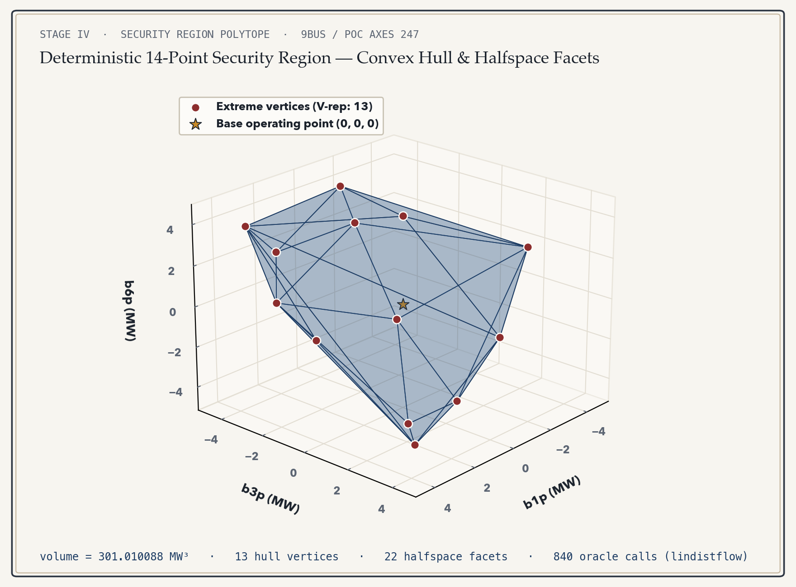
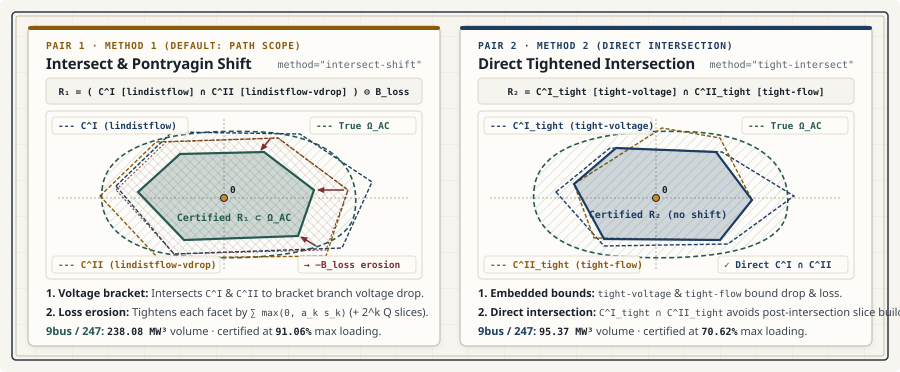
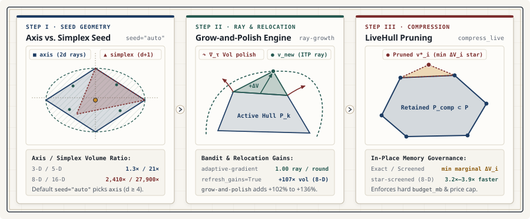
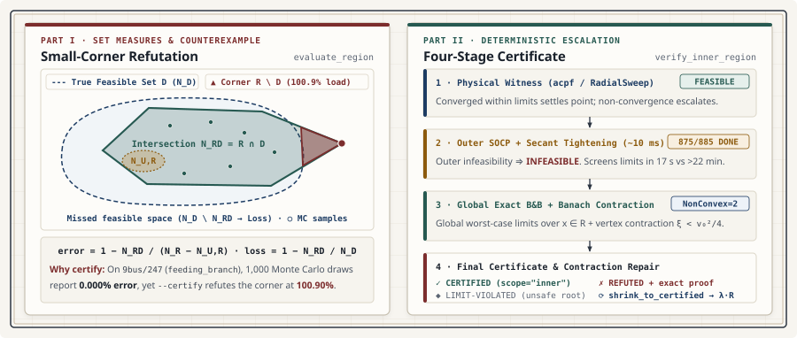

# OpenRC — Open Region Computation Library

[](https://openrc.scgong.com/)
[](pyproject.toml)
[](LICENSE)
[](https://doi.org/10.1109/TPWRS.2023.3324246)
[](docs/openrc_guide.pdf)

**Turn nonlinear power-grid limits into a reusable convex polytope `A Δu ≤ b` — built and certified offline once, dispatched online as a ~0.38 ms linear program.**

[**Interactive Docs & 2-D Lab ↗**](https://openrc.scgong.com/) · [**Conventions**](#core-conventions-read-first) · [**Installation**](#installation--solver-matrix) · [**3 Canonical Workflows**](#three-canonical-workflows) · [**Guarantees & Stack Selection**](#guarantees--stack-selection) · [**Architecture & Peers**](#architecture--peer-comparison) · [**CLI & Diagnostics**](#cli-driver--troubleshooting) · [**Citation**](#citation)

---

OpenRC constructs, compresses, validates, globally certifies, and dispatches steady-state security regions (*hosting-capacity regions*, *feasible operating regions*, or *dynamic operating envelopes*) across selected points of connection (POCs) on **radial and meshed** power networks.

<p align="center">
  
  <br/>
  <em>Figure 1 — Five-stage pipeline decoupling grid physics (<code>FeasibilityOracle</code>) from polyhedral geometry, compression, certification, and downstream LPs.</em>
</p>

## Core Conventions (Read First)

- **Load Sign (`+ΔP, +ΔQ > 0`):** Net demand drawn *from* the network (MW, Mvar).
- **Export Sign (`−ΔP, −ΔQ < 0`):** Distributed PV, wind, or battery injection *into* the network.
- **Physical Units & Artifacts:** `MW`, `Mvar`, `kV`, `kA`, `p.u.`; `.save(path)` writes immutable vertex `.csv` + SHA-256 provenance `.json` sidecars.
- **0-Based Bus Indexing:** All Python and `pandapower` bus IDs are **0-based**. Named paper presets on `9bus` translate 1-based paper POC numbers automatically:

| Axis Spec | Paper POC (1-Based) | Python Bus (0-Based) | Axis Labels |
| :--- | :--- | :--- | :--- |
| `"247"` | POCs 2, 4, 7 | `[1, 3, 6]` | `('b1p', 'b3p', 'b6p')` |
| `["1p", "1q"]` | POC 2 (P & Q) | `bus 1` | `('b1p', 'b1q')` |
| `"all8"` | Buses 1..8 (Slack = 9) | `0..7` (`slack_bus=8`) | `('b0p', …, 'b7p')` |

## Installation & Solver Matrix

Python 3.9+ runs the core library and all three canonical examples **without any commercial solver**.

**macOS / Linux**

```bash
git clone https://github.com/eesgong/OpenRC.git
cd OpenRC
python3 -m venv .venv
.venv/bin/python -m pip install -e .
.venv/bin/python examples/quickstart.py
```

**Windows PowerShell**

```powershell
git clone https://github.com/eesgong/OpenRC.git
cd OpenRC
python -m venv .venv
.\.venv\Scripts\python.exe -m pip install -e .
.\.venv\Scripts\python.exe examples\quickstart.py
```

Optional extras: `pip install -e ".[viz]"`, `".[mosek]"`, `".[gurobi]"`, or `".[dev]"`. To reproduce the exact **Python 3.13.9 / macOS arm64** numerical benchmark environment, install [`requirements-benchmark.txt`](requirements-benchmark.txt) followed by `pip install --no-deps -e .`.

| Oracle(s) | Solver Needed | Primary Role |
| :--- | :--- | :--- |
| `lindistflow`, `lindistflow-vdrop`, `tight-voltage`, `tight-flow` | **None** (closed-form analytic) | ~25 µs linear rays & conservative inner convex intersections |
| `acpf`, `dcpf`, `dcopf`, `acopf` | **None** (`pandapower` Newton / OPF) | Radial & **meshed** AC/DC checks and redispatch OPF |
| `socp` | MOSEK or Gurobi (`pyomo`) | Second-order cone outer-relaxation screening |
| `exact` | Gurobi (`NonConvex=2`) | Global nonconvex branch-flow adjudication & surface proof |

> **Tri-valued verdicts:** Every oracle returns `Verdict.FEASIBLE`, `Verdict.INFEASIBLE`, or `Verdict.INCONCLUSIVE` — solver non-convergence or missing licenses never silently masquerade as physical infeasibility.

## Three Canonical Workflows

### 1. Conservative Radial Inner Hull, Compression, 300 LPs & AC Audit (`examples/quickstart.py`)

<!-- example:quickstart:start -->
```python
import numpy as np
import OpenRC as orc

if __name__ == "__main__":
    case = orc.get_case("9bus")
    axes = case.resolve_axes("247")  # paper POCs 2,4,7 -> buses 1,3,6
    run = orc.get_builder(
        "conservative", method="tight-intersect", tighten_scope="subtree",
    ).build(case, axes, max_vertices=24)
    small = orc.get_compressor("local-search").compress(
        run.polytope, target_vertices=14,
    )
    scenarios = np.random.default_rng(0).uniform(0.8, 1.0, size=(300, len(axes)))
    batch = orc.get_application("capacity-allocation").solve_batch(
        small.polytope, scenarios,
    )
    # Draw inside the region to audit violations; this does not measure lost volume.
    audit = orc.evaluate_region(
        small.polytope, case, axes, reference="acpf", adjudicate=False,
        sampler="in-region", n_samples=400, rng=0,
    )
    print(run.summary(), small.summary(), batch.summary(), audit.summary(), sep="\n")
```
<!-- example:quickstart:end -->

Produces `theorem_backed: True` (46 → 14 vertices, ~258.0 MW³, ~5.7% compression loss), solves 300 `capacity-allocation` LPs (~0.38 ms/LP), and verifies `0 / 400` AC violations (95% Wilson CI `[0, 0.951%]`).

<p align="center">
  
  <br/>
  <em>Figure 2 — 3-D conservative security polytope on <code>9bus</code> (<code>"247"</code>) and its 14-vertex inner-preserving compression.</em>
</p>

### 2. Import Any `pandapower` Network (`examples/my_network.py`)

<!-- example:my_network:start -->
```python
import pandapower.networks as pn
import OpenRC as orc

if __name__ == "__main__":
    case = orc.case_from_pandapower(
        pn.mv_oberrhein(), feeder=1, slack_vm_pu="setpoint", load_scale=0.5,
    )
    axes = case.resolve_axes(["30p", "60p", "90p"])  # 0-based bus IDs
    run = orc.get_builder(
        "conservative", method="tight-intersect", tighten_scope="subtree",
    ).build(case, axes, max_vertices=24)
    audit = orc.evaluate_region(
        run.polytope, case, axes, reference="acpf", adjudicate=False,
        sampler="in-region", n_samples=200, rng=0,
    )
    print(run.summary(), audit.summary(), sep="\n")
    run.save("out/my_feeder")  # CSV + SHA-256 JSON sidecar
```
<!-- example:my_network:end -->

### 3. Reproduce Archived IEEE TPWRS Volume Within 50 ppm (`examples/reproduce_paper.py`)

<!-- example:reproduce_paper:start -->
```python
import math
import OpenRC as orc

if __name__ == "__main__":
    case = orc.get_case("9bus")
    axes = case.resolve_axes("247")
    with orc.get_oracle("lindistflow", case) as oracle:
        run = orc.get_builder(
            "expansive", policy="volume-gain", refresh_gains=False,
            ray_kwargs={"tol": 1e-5},
        ).build(case, axes, oracle, max_vertices=14)
    ppm = (run.volume / 301.000642981 - 1) * 1e6
    print(f"{run.volume:.9f} MW^3 ({ppm:+.1f} ppm)")
```
<!-- example:reproduce_paper:end -->

## Guarantees & Stack Selection

OpenRC separates **analytical radial theorems**, **finite-sample statistical audits**, and **global nonlinear surface proofs** so guarantees are never conflated:

| Tier | Entry Point / Flag | What Is Proven | Scope & Exclusions |
| :--- | :--- | :--- | :--- |
| **1. Analytical Inner** | `ConservativeBuilder(..., method="tight-intersect", tighten_scope="subtree")` → `run.builder_info["theorem_backed"] == True` | Exact radial branch-flow inner convex intersection (`tight-voltage` ∩ `tight-flow`, 0 LP) | Radial trees only; align slack voltage (`slack_vm_pu="setpoint"`) & shunts (`line_charging="constant"`) when auditing against `acpf` |
| **2. Statistical Audit** | `orc.evaluate_region(..., reference="acpf")` | 95% Wilson confidence interval (`error_rate_ci`) over `n_samples` nonlinear checks | Finite random draws cannot exclude narrow unexplored overload corners |
| **3. Global AC Proof** | `orc.certify_inner_region(...)` / `orc.shrink_to_certified(...)` | Worst-case facet bounds via Gurobi spatial B&B + Brouwer–Miranda solution existence | Requires licensed `.[gurobi]`; check `cert.certified`, `cert.status`, and `cert.scope == "inner"` |

### Recommended Stack by Operating Regime

| Regime | Topology | Builder & Key Arguments | Validation / Compression |
| :--- | :--- | :--- | :--- |
| **Solver-free radial inner (recommended)** | Single radial feeder | `orc.get_builder("conservative", method="tight-intersect", tighten_scope="subtree")` | `local-search` + `evaluate_region(..., reference="acpf")` |
| **Full-feeder path erosion (Method 1)** | Radial (all active POCs, e.g. `"all8"`) | `orc.get_builder("conservative", method="intersect-shift", shift_scope="path")` | Never use paper-only `shift_scope="feeding_branch"` for safety claims |
| **Globally certified radial AC inner** | Single radial feeder | `ConservativeBuilder` or `orc.shrink_to_certified(...)` | `certify_inner_region(..., backend="gurobi")` |
| **High-dimensional (`d = 5–16`)** | Radial or meshed | `orc.get_builder("memory-aware", budget_mb=64.0, compressor="star-screened")` | Bounds `LiveHull` facet explosion in RAM |
| **Meshed / multi-substation grid** | Looped HV/MV or multi-slack | `orc.get_builder("expansive", policy="adaptive-ema")` with `orc.get_oracle("acopf", case)` (or `"acpf"`) | `evaluate_region(..., reference="acopf")` |

<details>
<summary><strong>Visual Plates: Conservative Intersection, Adaptive Growth & Global Certification (Click to expand)</strong></summary>

<p align="center">
  
  <br/><em>Method 1 (<code>intersect-shift</code>) vs. Method 2 (<code>tight-intersect</code>) convex inner approximations.</em>
</p>

<p align="center">
  
  <br/><em>Adaptive facet selection, <code>LiveHull</code> memory governance, and inner-preserving subset compression.</em>
</p>

<p align="center">
  
  <br/><em>Evidence-aware validation vs. global Gurobi surface maximization and contraction proof.</em>
</p>

</details>

## Architecture & Peer Comparison

OpenRC exposes **92 top-level exports** (`import OpenRC as orc`) across **9 decoupled layers** and **16 pluggable `@register` registries** (`63` ready-to-run grids: `9bus`, `9bus-scaled`, `cigre-hv`, plus all `60` `pp:<name>` networks in `pandapower.networks`):

| Layer | Module | Role |
| :--- | :--- | :--- |
| **1. Cases** | `OpenRC.cases` | `GridCase`, 0-based `RegionAxes`, immutable network data, guarded `case_from_pandapower` |
| **2. Power Flow** | `OpenRC.powerflow` | Analytic DistFlow (`25 µs`), conic `socp`, global `exact`, and `pandapower` `acpf`/`dcpf`/`dcopf`/`acopf` |
| **3. Geometry** | `OpenRC.geometry` | `Polytope`, `LiveHull`, halfspaces, intersections, 2-D/subspace `slice`, ray bisection |
| **4. Construction** | `OpenRC.region` | Seeds, `expansive` bandit policies, `memory-aware` builder, `conservative` Methods 1 & 2 |
| **5. Compression** | `OpenRC.compression` | Inner-preserving `local-search`, `star-screened`, `hybrid-vns`, and budget schedules |
| **6. Validation** | `OpenRC.validation` | Samplers, Wilson CIs, multi-stage adjudication, `certify_inner_region`, `prove_existence` |
| **7. Applications** | `OpenRC.applications` | Topology-free `capacity-allocation` and `storage-sizing` LPs (`~0.38 ms/solve`) |
| **8. Execution** | `OpenRC.parallel`, `OpenRC.resources`, `OpenRC.viz` | Spawn-safe worker pools, call/time/RSS/hull budgets, 2-D & 3-D region plotting |
| **9. Benchmarks** | `OpenRC.benchmark` | Paired multi-seed experiments with bootstrap geometric-mean confidence intervals |

### OpenRC vs. Peer Approaches

| Approach | Output Representation | AC Safety Guarantee | Online LP Dispatch? | Primary Fit |
| :--- | :--- | :--- | :--- | :--- |
| **Batch PF / Monte Carlo** | Discrete point cloud | Checked at sampled points only | No (re-runs PF) | Historical time-series replay |
| **Repeated NLP / SOCP OPF** | Single dispatch vector | Pointwise exact / conic outer | No (full grid NLP) | Centralised real-time DSO OPF |
| **Axis-Aligned Box DOEs** | Fixed box `∏ [Pⱼ⁻, Pⱼ⁺]` | Inner on monotone radial | Fixed per-bus cap only | Uncoordinated smart-meter limits |
| **Linear PTDF / mpLP** | Halfspaces `A u ≤ b` | Optimistic (ignores `I²R` losses) | Yes (uncertified) | Lossless HV DC corridors (`d ≤ 5`) |
| **OpenRC (`v0.1.1`)** | **Vertices + `A Δu ≤ b`** | **3-tier: DistFlow / Wilson CI / Global B&B** | **Yes (`~0.38 ms`)** | **Coupled multi-POC flexibility & topology-free EMS** |

<details>
<summary><strong>Cross-Network Benchmark Plate (Click to expand)</strong></summary>

<p align="center">
  
</p>

</details>

## CLI Driver & Troubleshooting

Run the 13-subcommand CLI driver and guided 14-step tutorial from a cloned repository root:

```bash
python scripts/demo.py list                                   # inspect all 16 component registries
python scripts/demo.py case --case pp:mv_oberrhein --feeder 1 # inspect converted pandapower feeder
python scripts/demo.py conservative --case 9bus --axes 247 --method tight-intersect --tighten-scope subtree --validate
python scripts/demo.py apply --case 9bus --axes 247 --app capacity-allocation --n-scenarios 300
python examples/tutorial.py --list                            # list all 14 progressive tutorial steps
```

<details>
<summary><strong>Common Exceptions & Instant Remedies (16 Structured Diagnostics)</strong></summary>

| Exception | Violated Assumption | Actionable Fix |
| :--- | :--- | :--- |
| `MeshedNetworkError` | Grid is meshed/multi-feeder; DistFlow requires a single radial tree | Extract one feeder (`feeder=k`) or switch to `acpf`, `dcpf`, `dcopf`, or `acopf` |
| `UnratedBranchError` | Conservative loss bounds need thermal `rate_ka` on active lines | Pass `default_rating_ka=...` to `case_from_pandapower` (or `--default-rating-ka`) |
| `AmbiguousSlackError` | Substation slack bus cannot be inferred uniquely | Define `net.ext_grid` or pass `slack_bus_override=...` |
| `InfeasibleOriginError` | Base operating point `Δu = 0` violates limits or fails to converge | Scale base loading (`load_scale`), pass a feasible `origin=...`, or align `slack_vm_pu="setpoint"` |
| `SolverUnavailableError` | Requested `socp` / `exact` without MOSEK or Gurobi installed | Use solver-free `ConservativeBuilder` + `acpf`, or install `.[mosek]` / `.[gurobi]` |
| `MemoryBudgetExceeded` | Facet count or process RSS exceeded configured MiB cap | Switch to `MemoryAwareBuilder(budget_mb=..., compressor="star-screened")` |

See the full searchable **16-Exception Diagnostics Codex** and **Python API Reference** at [**openrc.scgong.com**](https://openrc.scgong.com/?view=reference#diagnostics) or in [`docs/openrc_guide.pdf`](docs/openrc_guide.pdf).

</details>

## Repository Layout & Caution

```text
OpenRC/
├── OpenRC/                  # Core package (92 public exports, 16 registries, PEP 561 typed)
├── examples/                # quickstart.py, my_network.py, reproduce_paper.py, tutorial.py
├── scripts/                 # demo.py (13 subcommands), benchmark*.py, generate_readme_figures.py
├── tests/                   # Automated physics, geometry, provenance & CLI test suite
├── docs/                    # Complete user & method guide (openrc_guide.pdf / .tex) & figures
└── .github/workflows/       # Solver-free multi-Python CI (ruff, mypy, tests, examples)
```

> **Caution:** OpenRC is an MIT-licensed research and engineering software library, not a certified real-time protection or SCADA safety system. Validate all network models, ratings, and operating limits independently before field deployment.

## Citation

If OpenRC is helpful to your research or engineering work, we would appreciate a citation to our *IEEE Transactions on Power Systems* paper:

```bibtex
@article{gong2024multidimensional,
  author  = {Gong, Sicheng and {\'C}uk, Vladimir and Cobben, J. F. G.},
  title   = {Multidimensional Hosting Capacity Region in {Dutch MV} Grid Congestion Management},
  journal = {IEEE Transactions on Power Systems},
  volume  = {39},
  number  = {3},
  pages   = {5024--5035},
  month   = may,
  year    = {2024},
  doi     = {10.1109/TPWRS.2023.3324246}
}
```
